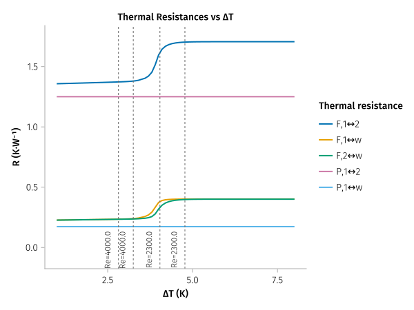
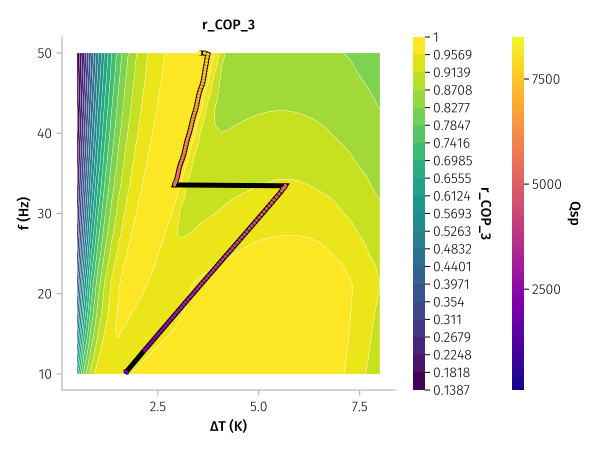
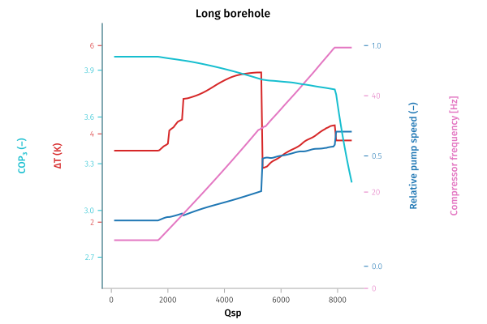

# Introduction

Ground source heat pumps (GSHPs) have emerged as essential technologies for decarbonizing the heating sector, offering superior energy efficiency compared to conventional heating systems by exploiting relatively stable underground temperatures. Central to maximizing the performance of these systems is the optimization of fluid flow rates through ground heat exchangers, which directly influences both system efficiency and operational costs.

However, current understanding of optimal flow control in GSHP systems remains fragmented across different system configurations and operational conditions. Most existing studies focus on either empirical optimization of specific installations or theoretical analysis of idealized systems, with limited integration between fundamental heat transfer principles and practical system constraints. Furthermore, the complex thermal-hydraulic coupling between heat pump performance, borehole heat exchanger effectiveness, and pump power consumption has not been systematically analyzed using physically-based models that can capture the nonlinear interactions between these subsystems.

To address these limitations, this study develops a comprehensive thermal-hydraulic model of GSHP systems that integrates detailed thermodynamic cycle analysis with borehole heat exchanger physics and pump hydraulics. Using the Julia ModelingToolkit ecosystem, we implement an equation-based modeling approach that enables simultaneous solution of all system equations while maintaining physical consistency across subsystem boundaries. Our analysis focuses on systems with direct hydraulic coupling between the heat pump and ground heat exchanger, representing a common configuration in residential and small commercial applications. Through parametric analysis of the coupled model, we identify fundamental relationships between flow rates, temperature differences, and system performance, providing insights that may inform both system design and control strategy development.

# Literature Review

<!-- MISSING CONTENT ANALYSIS:
1. FLOW REGIME MODELING: The paper focuses on laminar-turbulent transition but lacks coverage of transition modeling approaches, entry length effects, and regime classification methods specifically for BHE applications.
   - Need to cite: @salhein2022control (discusses optimal velocity ranges for different pipe diameters)
   - Consider: @delcol2014experimental (experimental flow boiling and transition effects)

2. PHYSICS-BASED BHE MODELS: Limited discussion of detailed thermal resistance networks, multipole method implementations, and analytical solutions for U-tube configurations that form the foundation for the thermal model used.
   - Need to cite: @claesson2018explicit (explicit multipole formulas for U-tube thermal resistance)
   - Need to cite: @Claesson2004 (plate heat exchanger modeling with flow regimes)

3. EXPERIMENTAL VALIDATION: Missing comprehensive experimental studies validating coupled thermal-hydraulic models under varying flow conditions, especially in transition regimes.
   - Need to cite: @li2024field (field test validation of GSHP systems)
   - Need to cite: @bordignon2024evaluation (long-term performance evaluation)
   - Need to cite: @benassi2015energy (experimental data on variable speed systems)

4. FLUID PROPERTY EFFECTS: Insufficient coverage of secondary fluid property impacts (viscosity, thermal conductivity, heat capacity) on optimal flow rates, particularly for antifreeze solutions.
   - Need to cite: @menegazzo2022state (discusses secondary fluids and nanofluids)
   - Need to cite: @karlsson2006capacity (capacity control with different fluids)

5. SYSTEM-LEVEL OPTIMIZATION: Limited discussion of simultaneous optimization across all subsystems (compressor frequency, pump speed, BHE sizing) and multi-objective approaches.
   - Need to cite: @ma2020recent (comprehensive review of design and control optimization)
   - Need to cite: @atam2015design (optimal design approaches)
   - Need to cite: @gao2016optimization (optimization of small-scale systems)
   - Need to cite: @ikeda2017optimization (multi-source operation optimization)

6. REAL-TIME CONTROL: Missing coverage of adaptive control strategies that can respond to changing ground conditions, seasonal variations, and system degradation.
   - Need to cite: @gao2022optimal (optimal control for thermal environment)
   - Need to cite: @zhou2024study (operation optimization with dynamic conditions)
   - Need to cite: @mu2015extremum (extremum seeking control)

7. ECONOMIC ANALYSIS: Limited treatment of life-cycle cost optimization and trade-offs between energy savings and parasitic pumping power from economic perspectives.
   - Need to cite: @mader2014capacity (total cost of ownership analysis)
   - Need to cite: @capozza2015long (long-term economic analysis)

8. FIELD PERFORMANCE: Insufficient data on long-term field performance validation of optimal flow control strategies across different climates and system configurations.
   - Need to cite: @li2024field (field test results and validation)
   - Need to cite: @somogyi2016scientific (European field performance review)
   - Need to cite: @cervera2016control (experimental one-year operation results)

9. HYBRID SYSTEMS: Limited coverage of GSHP integration with other renewable sources and storage systems where flow optimization becomes more complex.
   - Need to cite: @bordignon2024evaluation (dual-source heat pump evaluation)
   - Need to cite: @ikeda2017optimization (hybrid GSHP with multiple sources)

10. MODELING TOOLS: Incomplete review of available modeling frameworks, their capabilities, limitations, and suitability for different types of flow optimization studies.
    - Need to cite: @ma2020recent (review of modeling approaches)
    - Need to cite: @atam2015ground (modeling and control challenges)
    - Need to cite: @menegazzo2022state (state-of-art modeling tools)
-->

## Theoretical Foundations and Early Work

The theoretical foundations for optimal flow control in heat pump systems were established by Granryd [@granryd2010analytical], who derived analytical expressions for optimum flow rates in evaporators and condensers of heat pumping systems. This seminal work provided the mathematical framework for understanding how flow velocities on air or liquid sides significantly affect system performance, leading to design relations that maximize overall coefficient of performance (COP) by considering energy demands for compressors, pumps, and fans. Granryd's analytical approach demonstrated that optimal flow rates result from balancing increased heat transfer effectiveness against parasitic pumping power, establishing the theoretical basis for subsequent flow optimization research.

## Flow Control Optimization Studies

### Groundbreaking Control Strategies

Edwards and Finn [@edwards2015generalised] developed a groundbreaking control strategy for predicting optimal ground source heat pump water flow rates under part load operation. Their work demonstrated that optimal flow rates could be calculated from available design data and minimal on-line measurements, resulting in seasonal system performance (SPF3) improvements of 20-40% compared to nominal flow rate operation, particularly beneficial for the prevalent low-load conditions during heating and cooling seasons. The study established that optimal internal water flow rate decreases as part load decreases, while optimal external water flow rate remains relatively constant.

### Empirical Optimization Methodologies

Montagud et al. [@montagud2013situ] developed a comprehensive in situ experimental methodology for optimizing water circulation pump frequencies in GSHP systems. Their three-step approach, involving experimental characterization, quasi-steady state performance mapping, and extrapolation to partial load conditions, demonstrated potential annual energy savings of up to 28%. This methodology was subsequently extended by Cervera-Vázquez et al. [@cervera2014situ] to multistage heat pump units, achieving even higher energy savings of up to 32% through optimized pump frequency control.

Zarrella et al. conducted a comprehensive simulation-based analysis of variable flow pumping in ground source heat pump systems with different types of borehole heat exchangers. Their study compared constant speed circulation pumps with variable flow controlled by maintaining constant temperature difference across the heat pump on the ground side. The analysis revealed that while constant speed pumps provided better heat pump energy performance, variable flow control with constant temperature difference offered optimal system-wide efficiency when considering parasitic pumping energy.

### Advanced Control Algorithms

De Ridder et al. [@de2011optimal] presented an optimal control algorithm for borehole thermal energy storage systems using dynamic programming techniques. Their approach successfully managed system constraints while minimizing operation costs, demonstrating robustness across various weather scenarios. The study highlighted the importance of thermal storage management in optimizing overall system performance.

Mu et al. introduced extremum seeking control (ESC) for efficient operation of hybrid ground source heat pump systems. Their self-optimizing control scheme eliminated the need for detailed plant models by using feedback of total power consumption and control inputs of relative flow rate and pump speed. The ESC approach achieved nearly optimal efficiency without requiring extensive system modeling, representing a significant advancement in model-free optimization methods.

## Variable Speed Systems and Advanced Technologies

Benassi and Mantovan [@benassi2015energy] conducted comprehensive experimental and modeling studies of a GSHP system with variable speed compressor, water pumps, and fans. Their work established that at higher load ratios, maximum COP3 is obtained for a water temperature difference of about 5K at the condenser and 2.8K at the evaporator, while at partial loads, maximum efficiency is achieved at minimum water flow rates to both borehole heat exchangers and building circuits due to heat exchanger oversizing. The study demonstrated potential for 30% improvement in seasonal COP when using brushless DC motor compressors instead of inverter-driven asynchronous motors.

The economic viability of variable speed control was analyzed by Mader and Madani [@mader2014capacity], who compared variable speed versus on/off control in air-water heat pumps across different climate zones. Their total cost of ownership analysis found that variable speed control becomes increasingly profitable in colder climates, with potential savings of up to 5000 EUR over 15 years of operation compared to on/off control.

## System Integration and Modeling

Corberán et al. [@corberan2010quasi] presented a quasi-steady state mathematical model of an integrated GSHP system for building space control. Their validated model revealed that higher water return temperatures reduce heat pump ON time operation and result in approximately 5% increase in daily heat pump seasonal performance factor per degree increase in building water return temperature. The study emphasized the critical importance of considering building circuit variables in overall system performance optimization.

Beaudry et al. [@beaudry2022flow] investigated flow rate control in standing column wells, showing that variable flow rate control maintaining a 2°C temperature difference across the plate heat exchanger can generate 8-11% annual energy savings while reducing groundwater usage. This work extended flow optimization concepts to specialized GSHP configurations with groundwater interaction.

## Comprehensive Reviews and Recent Developments

### Modeling and Control Reviews

Atam and Helsen [@atam2015ground] provided a comprehensive two-part review of modeling and optimal control challenges in ground-coupled heat pump systems. Their analysis highlighted that mathematical model-based control approaches achieve performance within 10% of dynamic programming-based optimal control. However, they identified control-oriented borefield modeling as a critical bottleneck, particularly for predicting thermal behavior accounting for thermal interaction between boreholes, groundwater flow effects, and multi-layer ground characteristics.

## Long-term Performance Analysis

Capozza et al. [@capozza2015long] conducted extensive analysis of two GSHP systems using validated numerical models, proposing optimization strategies for operating parameters. Their work emphasized the importance of considering seasonal variations and long-term ground thermal evolution in control strategy development, demonstrating that short-term optimization strategies may not be optimal over the system's operational lifetime.

## Research Gaps and Current Limitations

Despite significant progress in GSHP flow control optimization, several critical gaps remain in the current literature:

1.  **Integration of detailed physics-based models**: Most optimization studies rely on empirical correlations or simplified models that may not capture the full complexity of thermal-hydraulic coupling in GSHP systems.

2.  **Comprehensive system-level optimization**: While individual components have been optimized separately, few studies address the simultaneous optimization of all subsystem interactions including refrigerant cycle, borehole heat exchanger, and pumping system.

3.  **Validation under realistic conditions**: Many theoretical studies lack validation against real system performance data under varying operational conditions and system configurations.

4.  **Generalizability across system types**: Most studies focus on specific system configurations, limiting the applicability of findings to broader GSHP system designs.

The present study addresses these gaps by developing a comprehensive thermal-hydraulic model that couples detailed thermodynamic cycle analysis with borehole heat exchanger physics and pump hydraulics, enabling systematic investigation of optimal flow control strategies across different system configurations and operating conditions.

## Modeling Frameworks

The complexity of GSHP systems has necessitated careful selection of modeling tools and frameworks. Various options exist, each with distinct advantages and limitations:

**EES (Engineering Equation Solver)** represents the traditional approach to heat pump cycle modeling, offering rapid setup of steady-state vapor compression cycles with extensive built-in refrigerant property databases. While excellent for teaching and quick optimization studies, EES is primarily limited to steady-state analysis and lacks detailed borehole heat exchanger models.

**Modelica Ecosystem** tools, including commercial solutions like Modelon VCL and TIL Suite, as well as open-source libraries such as ThermoCycle, Buildings, and AixLib, provide sophisticated moving-boundary heat exchanger models with geometry-based heat transfer coefficient and pressure drop correlations. However, commercial libraries come with significant licensing costs and proprietary restrictions.

**TRNSYS (Type 557)** has established itself as a standard tool for building and ground source heat pump studies, particularly excelling in seasonal GSHP simulations, though it relies on lumped/empirical cycle models rather than detailed moving-boundary heat exchanger physics.

**Python-based tools** have emerged as popular open-source alternatives, with CoolProp providing thermophysical properties, TESPy enabling process modeling for steady-state heat pump cycles, and pygfunction offering state-of-the-art borefield modeling capabilities.

We decided to implement the model from scratch using ModelingToolkit.jl. This ecosystem exists as part of the Julia programming language and is similar in principle to Modelica: an acausal component-based framework. Key reasons for this choice include: free and open source nature, excellent symbolic computation capabilities, and seamless integration with advanced optimization and machine learning ecosystems.

# Methods

## System Model Architecture

The GSHP system model consists of three coupled submodels that are solved together: thermodynamic cycle (thermal system), borehole heat exchanger, and pump hydraulics (hydraulic system). The steady-state system is solved using ModelingToolkit.jl with symbolic manipulation and NonlinearSolve.jl library for the solvers.

The model implementation prioritizes modularity and extensibility, allowing for easy modification of individual components while maintaining system-level coupling consistency. The thermal-hydraulic separation enables efficient parameter studies and optimization while ensuring physical consistency through the coupling interface. The model architecture employs a modular approach typical of ModelingToolkit, where fundamental components such as thermophysical properties are defined first and then used to build parent components like the pump and compressor. Both the thermal and hydraulic models are coupled through mass flow (the secondary fluid mass flow from the thermal system sets the design flow for the hydraulic system), temperature (borehole inlet/outlet temperatures link the thermal and hydraulic properties), and performance feedback (pump power from the hydraulic system feeds into overall system KPIs). The solution strategy follows a sequential approach: first, the thermodynamic cycle is solved for given boundary conditions; next, mass flows, temperatures, and thermal loads are extracted; then, the hydraulic system is solved using these outputs as boundary conditions; finally, thermal and hydraulic results are combined to compute overall system performance metrics, including auxiliary heating requirements if the heat pump capacity is insufficient.

### Thermophysical properties:

Clapeyron.jl and EntropyScaling are used for determining the properties of the refrigerant. CoolProp correlations are used for the secondary fluid.

### Thermodynamic Cycle:

The thermodynamic cycle implements a R134A cycle with the following components:

#### Evaporator:

A moving-boundary plate heat exchanger evaporator with dynamically allocated regions for two-phase evaporation and single-phase superheating. The model features:

-   **Geometric modeling**: Chevron plate geometry with adjustable plate spacing (b), number of plates (np), width (W), enlargement factor (ϕ), and chevron angle (β)
-   **Two-zone heat transfer**: The evaporator length is split between evaporation and superheating zones. The fraction of the HX occupied by each zone is a variable.
-   **Heat transfer correlations**:
    -   Two-phase region: Amalfi correlation for convective boiling in plate heat exchangers (averaged over a vapor quality range)
    -   Superheating region: Martin correlations for single-phase plate heat exchanger flow with laminar-turbulent (smooth) transition
-   **Boundary conditions**: Fixed superheat degree (ΔTSH) and secondary fluid temperature difference (ΔTSF) as control variables

The smooth transition is necessary for the solver to

-   **Friction**: Darcy-Weisbach equations with smooth transition between laminar and turbulent regimes using error function blending
-   **Friction factor**: Enhanced Colebrook-White correlations
-   **Heat exchanger losses**: Chevron-plate correlations based on Martin's work for pressure drop in plate heat exchangers

#### Compressor:

The compressor model incorporates:

1.  **Volumetric displacement**: Fixed displacement volume with frequency-controlled capacity -

2.  **Isentropic efficiency**: Constant isentropic efficiency

#### Expansion Valve:

Modeled as an isenthalpic expansion process. A constraint imposed in the solver is the superheating degree.

#### Condenser:

Simplified model assuming constant condensing temperature and specified subcooling degree (ΔTSC). The detailed condenser heat transfer is not modeled, focusing on the evaporator side.

### Borehole Heat Exchanger:

The U-tube grouted borehole is simulated by two different models:

#### Thermal: {#sec-method_thermal}

-   **Analytical solution**: Uses eigenvalue decomposition of coupled 1D ODEs to solve the temperature profiles along the borehole depth
-   **Multipole method**: For the grout resistance, we implement thermal resistance calculations between pipes and to the borehole wall using multipole approximations for complex geometry effects **ref needed**
-   **Heat transfer coefficients**: Derived from the borehole geometry and dynamical fluid properties
-   **Boundary conditions**: Uniform borehole wall temperature as the thermal boundary condition
-   **Temperature profiles**: Analytical expressions for fluid temperatures in both legs as functions of depth

#### Hydraulic:

The borehole thermal model is connected to the hydraulic system through temperature-dependent fluid properties.

-   **Pipe friction**: Darcy-Weisbach equations with smooth transition between laminar and turbulent regimes using smooth blending (erf)
-   **Friction factor**: Enhanced Colebrook-White correlations with automatic regime detection
-   **Component-wise pressure drops**: Individual calculation for each system component (evaporator, borehole, connecting pipes)

## Pump

Since the hydraulic model is decoupled from the thermal model, there is no feedback from hydraulic losses to the thermal model, which is a limitation that affects the high flow simulations. In reality, better performance is expected thanks to the added heat in the heat source loop, both because of electrical losses as well as the conversion of work into heat due to frictional losses.

### Pump Performance:

The centrifugal pump follows dimensionless performance curves based on affinity laws:

-   **Head coefficient**: $\psi = \psi_0 - K \cdot \varphi^2$ where $\varphi$ is the flow coefficient

-   **Efficiency**: $\eta = \eta_{\text{max}} \left(1 - \left(\frac{\varphi - \varphi_{\text{BEP}}}{\varphi_{\text{BEP}}}\right)^2\right)$ with parabolic efficiency curve around the best efficiency point (BEP)

-   **Power calculation**: Electrical power including motor efficiency

## Performance Metrics:

The model calculates multiple performance indicators:

-   **COP 1**: $COP_1 = \frac{\dot{Q}_{cond}}{W_{comp}}$ (refrigeration cycle only)
-   **COP 2**: $COP_2 = \frac{\dot{Q}_{cond}}{P_{comp} + P_{pump}}$ (including pump power)
-   **COP 3**: $COP_2 = \frac{\dot{Q}_{cond} + P_{aux}}{P_{comp} + P_{pump} + P_{aux}}$ (including pump power)

### Numerical Implementation:

-   **Symbolic computation**: Full symbolic derivation of equations using ModelingToolkit.jl
-   **Robust solvers**: Multiple nonlinear solver options including RobustMultiNewton and TrustRegion methods
-   **Automatic differentiation**: Forward-mode AD for enhanced convergence properties
-   **Continuation methods**: Built-in parameter sweep capabilities with automatic stepping and convergence control

*Detailed system base parameters and correlations are provided in @sec-appendix-parameters.*

# Results:

## Insights into the physical process

In this section, we'll outline the case of a single simulation with the parameters described in @sec-appendix-parameters.

{#fig-thermal-resistances}

@fig-thermal-resistances shows that all the convective thermal resistances are lower at low delta T, which is expected.

Focusing on the borehole heat exchanger (BHE) efficiency, defined as: $$
1 - \frac{T_{\text{out}} - T_{\text{wall}}}{T_{\text{in}} - T_{\text{wall}}}
$$

{#fig-bh-efficiency}

@fig-bh-efficiency demonstrates how BHE efficiency varies with the temperature difference control parameter.

Schematically, this better efficiency leads to higher evaporation temperature:

{#fig-temperature-profiles}

Then, this higher temperature leads to a better capacity:

{#fig-energy-components}

When factoring in the pumping power, we therefore obtain the COP 3 figure:

We observe a clear peak around 3K Delta T. This is in line with the standard practice across the field.

## COPs vs. ΔT

{#fig-cop-vs-dt}

@fig-cop-vs-dt shows the main metrics we are considering: COPs against the control strategy under investigation: constant temperature difference across the evaporator/BHE.

The COP 3 is calculated such that the delivered heat is the heat delivered at the maximum case for this frequency.

We can see clearly that there is an optimal at 3.0K, around when the flow is fully turbulent in both legs of the BHE (see @sec-appendix-parameters for explanations)

## Robustness

### Scenarios

3 additional scenarios have been simulated with one difference for each variant:

-   "Cold wall", T wall is set to 5C instead of 10C

-   "Pure Water", the secondary fluid is pure water

%-   "Bigger pipes", the OD of the collector pipes is set to 40 instead of 32mm

-   "Longer collector", the collector is 200m instead of 150m

### Partial load

is a contour plot representing a 2d parametric exploration. The x axis is the set delta T for the secondary fluid. The ordinates represent the compressor frequency. The contours represent the COP 3(f) (see @sec- ), calculated as so: This COP3 is calculated for a given frequency. The maximum condenser heat that the HP can deliver at this frequency and then the necessary auxiliary heating to match it is added. It's a way to quantify the efficiency of the system while not having to choose a target Q cond.

On the diagram, several isolines are represented:

-   The iso pump speed are represented in black. The 30% and 100% speeds are represented in thick and each 10% step in between is a thinner line. Beyond these two boundaries, the physical system can actually not be operated.

-   Similarly, the maximum electrical power is also represented by such a line (dashed black). The operative envelope is also constrained by this additional parameter.

-   The different laminar to turbulent transitions of each legs of the BHE are represented by the onset and full transition iso Reynolds number (2300 and 4000).

In order to better visualize these ridges, we have calculated a relative COP 3 deficit for a given compressor frequency. NEEDS explanation

The ridge line in red corresponds to the location of this maximum used for the auxiliary heating calculation. The ridge line presents 2 regions:

-   In the top part, there is a clear ridge

-   In the bottom part, a hockey stick ridge is present

In the lower region, the behaviour of the system is dominated by the high borehole efficiency. In the top, the relative increase of pumping power is justified: it allows achieving turbulence in the collector, and therefore better BH efficiency. Conversely, achieving turbulence at low compressor speed is not worth the extra pumping power. In some sense, achieving turbulence is "having a high speed", regardless of the thermal load.

This second region is often not reachable in the base scenario: the pump minimum speed being too high and therefore does not allow for a low enough SF flow.

Focusing on the position of the ridge, one can see that, in the colder wall collector scenario, there seems to be a moment where switching the pump to the minimum in order to take advantage of the increased BH efficiency instead of wasting the pumping power trying to achieve turbulence in the collector.

Looking at the graph and coming back to the different ways to control a GSHP SF pump, we can make the following remarks about the following constant heuristic strategies:

-   *Delta T:* It necessarily fails at keeping the system on the ridge.

-   *Pressure drop:*  strategy could be

-   *Pump speed:* It cannot track the change either

-   *Compressor speed to pump speed ratio:* performs decently well over the transition, TODO

-   *Mass flow:* 

### Variations

To establish baseline performance characteristics, we initially examine a fundamental question: what constitutes the optimal rule-based control strategy under standard operating conditions?

The test case represents a typical Swedish GSHP installation. The system features a 250m deep borehole with a 32mm outer diameter polyethylene single U-tube collector. Complete technical specifications and thermal properties are detailed in @sec-appendix-parameters.

### Optimal operation

In this part, we used the simulation results of the forward problem to find the maximum using interpolation. We calculate the COP3 that can be realized and then optimization routines are used to find it.

{#fig-overlay_cop3}

@fig-overlay_cop3 shows this maximum overlaid onto the COP2 graph. What we see is that the pump envelope constrains the system at low Q heat. The "laminar optimum" is not reachable, but the lowest pump speed is nonetheless the optimal achievable point. Then there is a point where the system stops chasing the "laminar optimum" and switches instead to the "turbulent optimum". In some sense, this is from this point on that it becomes worth investing the extra pump capacity in order to achieve better BHE efficiency.

::: {layout-nrow=2}

{#fig-optimal_base}

{#fig-optimal_long}

{#fig-optimal_cold}

{#fig-optimal_water}

:::

The ensemble of figures shows both the maximum COP3 achievable for a given heat need as well as \Delta T, pump anjd compressor speeds. The figures represents both the base scenario as well as thee 3 variants we run. The pattern we see is as follow:

- First for low demand, the system operates at a constant operating point: it is "stuck" at minimum compressor speed and minimum pump speed.

- Then, once the capacity of this minimum speed is reached, the compressor speed is ramped up in a very linear way up to its maximum value. In parallel, we see that the pump stays at minimum speed, and then slowly ramps up to chase the optimum.

- First for low demand, the system operates at a constant operating point: it is "stuck" at minimum compressor speed.

- Then there can be a zone with constant Delta T or slightly sloped Delta T vs Pump speed/Delta T. This is when the system follows the turbulent optimum.

- When the system reaches the maximum capacity, the system settles in a regime where the capacity is increased at the cost of a slightly higher pump power, and this allows for relatively less penalty due to the auxiliary heating. However, this change is more subtle (between 0.1K and 1K of difference compared to the previous optimal delta T).

# Conclusions

It seems that the widespread rule based control perform decently in some test cases, however, there is considerable potential to increase the performances.

# Discussion

It remains to be seen if the same heuristic does as well when it comes to e.g. coaxial BHE. We suggest that the models be leveraged in order to produce better heuristics.

It is important to remember the model's assumptions when discussing these aspects. In the transition region, the behaviour is somewhat unclear. There is some entry length effect that happens in reality, the temperature is not uniform in each leg (-> some part of the same leg can be turbulent while the other is laminar). Regardless of these limitations, it does seem that the optimal flow is "right after the transition". However, as discussed, the classic rule based control strategies cannot track this transition point in a satisfactory manner.

This is a physics based model, however, even if the correlations used here are somewhat valiadted, comparing this model to true experimental data would be valuable. Fitting/identifacation techniques could also be employed to narrow down on parameters which are not easy to measure/known with certainty.

This paper has focused on creating a better understanding of the mechanism leading to an optimal operation for GSHP systems. However, there is considerable limitations in this study, eg. the condensation pressure is not varied once. The operating space has many dimensions, which makes it challenging to sample. Therefore, surrogates should be used in order to make the task of finding the optimal operating point doable. Ideeally, the model should be surrogatizeed after the experimental fitting, this way

FInally, there are some limitations which can not be addreessed with the techniques suggesteed above. The model is steady state, however, the borehole dynamics is paramount. A type of question to which we cannot answer is forr example "is it worth operating a little bit faster and letting it rest a fraction of the time?". The optimal dispatch problem is also completely overlooked here, since 

All in all, this paper contributes to advancing the understanding of optimal operation of GSHP, but more work is necessary in order to provide more actionable recommendations to manufacturer and practitioners.

# Nomenclature

## Symbols

**Geometric Parameters:**

- $D$ = Impeller diameter \[m\]

- $D_{bh}$ = Borehole diameter \[m\]\

- $D_{pipe,i}$ = Pipe inner diameter \[m\]

- $D_{pipe,o}$ = Pipe outer diameter \[m\]

- $H$ = Pump head \[m\]

- $L$ = Plate length \[m\]

- $L_b$ = Borehole depth \[m\]

- $N_{plates}$ = Number of plates \[-\]

- $W$ = Plate width \[m\]

- $b$ = Channel spacing \[m\]

- $s$ = Shank spacing \[m\]

- $t_{pipe}$ = Pipe wall thickness \[m\]

- $t_{plate}$ = Plate thickness \[m\]

**Thermophysical Properties:**

- $\lambda$ = Thermal conductivity \[W/(m·K)\]

- $\rho$ = Density \[kg/m³\]

- $\chi$ = Mass fraction \[-\]

- $\beta$ = Chevron angle \[rad\]

- $h$ = Specific enthalpy \[kJ/kg\]

**Flow and Transport Variables:**

- $\dot{V}$ = Volumetric flow rate \[m³/s\]

- $\dot{m}$ = Mass flow rate \[kg/s\]

- $\dot{Q}$ = Heat transfer rate \[W\]

- $N$ = Rotational speed \[rpm\]

- $P$ = Pressure \[bar, Pa\]

- $T$ = Temperature \[K, °C\]

- $\Delta T$ = Temperature difference \[K\]

**Dimensionless Parameters:**

- $\phi$ = Flow coefficient, $\dot{V}/(N \cdot D^3)$ \[-\]

- $\psi$ = Head coefficient, $g \cdot H/(N^2 \cdot D^2)$ \[-\]

- $\psi_0$ = Shutoff head coefficient \[-\]

- $K$ = Head curve slope parameter \[-\]

**Performance Parameters:**

- $COP$ = Coefficient of performance \[-\]

- $W$ = Work/Power \[W\]

- $\eta$ = Efficiency \[-\]

- $f$ = Frequency \[Hz\]

- $g$ = Gravitational acceleration \[m/s²\]

## Subscripts

-   $BEP$ = Best efficiency point

-   $comp$ = Compressor

-   $elec$ = Electrical

-   $evap$ = Evaporator

-   $grout$ = Grout material

-   $high$ = High pressure side

-   $in$ = Inlet condition

-   $is$ = Isentropic

-   $max$ = Maximum

-   $motor$ = Motor

-   $out$ = Outlet condition

-   $pipe$ = Pipe material

-   $plate$ = Plate material\

-   $pump$ = Pump

-   $ref$ = Refrigerant

-   $s$ = Isentropic condition

-   $shaft$ = Shaft

-   $soil$ = Soil/ground

-   $wall$ = Wall condition

## Abbreviations

-   $BHE$ = Borehole Heat Exchanger

-   $COP$ = Coefficient of Performance

-   $GSHP$ = Ground Source Heat Pump

-   $MEA$ = Monoethanolamine

-   $OD$ = Outer Diameter

-   $ID$ = Inner Diameter

-   $PE$ = Polyethylene

-   $SC$ = Subcooling

-   $SF$ = Secondary Fluid

-   $SH$ = Superheating

## Chemical Notation

-   $R134A$ = 1,1,1,2-Tetrafluoroethane (refrigerant)
-   $MEA$ = Monoethanolamine ($C_2H_7NO$)

# Appendix: Model Parameters and Technical Specifications {#sec-appendix-parameters}

## Detailed Mathematical Correlations

**Pump Performance Correlations:**

- Dimensionless head coefficient: $$\psi = \psi_0 - K \cdot \phi^2$$

- Dimensionless flow coefficient: $$\phi = \frac{\dot{V}}{N \cdot D^3}$$

- Dimensionless head coefficient: $$\psi = \frac{g \cdot H}{N^2 \cdot D^2}$$

- Pump efficiency: $$\eta_{pump} = \eta_{max} \left(1 - \left(\frac{\phi - \phi_{BEP}}{\phi_{BEP}}\right)^2\right)$$

where $N$ is rotational speed [rpm], $D$ is impeller diameter [m], $\dot{V}$ is volumetric flow rate [m³/s], $H$ is pump head [m], $\eta_{max}$ is maximum efficiency, and $\phi_{BEP}$ is flow coefficient at best efficiency point.

**Power Consumption:**

- Shaft power: $$P_{shaft} = \frac{\rho \cdot g \cdot \dot{V} \cdot H}{\eta_{pump}}$$

- Electrical power: $$P_{elec} = \frac{P_{shaft}}{\eta_{motor}}$$

**Compressor Work:**

- Isentropic compression work: $$W_{comp} = \dot{m}_{ref} \cdot \frac{h_{out,s} - h_{in}}{\eta_{is}}$$

where $\dot{m}_{ref}$ is refrigerant mass flow rate [kg/s], $h_{in}$ and $h_{out,s}$ are inlet and isentropic outlet specific enthalpies [kJ/kg], respectively.

## Borehole Heat Exchanger Specifications

**Geometric Parameters:**

- Borehole depth: $L_b = 250$ m

- Pipe outer diameter: $D_{pipe,o} = 32$ mm

- Pipe inner diameter: $D_{pipe,i} = 28.24$ mm

- Pipe wall thickness: $t_{pipe} = 1.88$ mm

- Borehole diameter: $D_{bh} = 115$ mm

- Shank spacing: $s = 75$ mm

**Thermal Properties:**

- Pipe thermal conductivity: $\lambda_{pipe} = 0.4$ W/(m·K)

- Grout thermal conductivity: $\lambda_{grout} = 1.5$ W/(m·K)

- Ground thermal conductivity: $\lambda_{soil} = 2.0$ W/(m·K)

- Boundary condition: $T_{wall} = 283.15$ K (if not specified otherwise)

## Heat Pump System Parameters

**Working Fluids:**

- Primary refrigerant: R134A

- Secondary fluid: MEA aqueous solution with mass fraction $\chi = 0.28$

**Compressor Specifications:**

- Isentropic efficiency: $\eta_{is} = 0.7$

- Operating frequency: $f = 50$ Hz

- Electrical motor efficiency: $\eta_{motor} = 0.9$

## Plate Heat Exchanger (Evaporator) Specifications

**Geometric Parameters:**

- Number of plates: $N_{plates} = 20$

- Plate width: $W = 0.1$ m

- Plate length: $L = 0.3$ m

- Channel spacing: $b = 1.5$ mm

- Chevron angle: $\beta = \pi/6$ rad $(30°)$

- Plate thickness: $t_{plate} = 0.5$ mm

- Plate thermal conductivity: $\lambda_{plate} = 16$ W/(m·K)

## Operating Conditions (test_GSHP Reference Case)

**Temperature Differences:** 

- Superheating temperature difference: $\Delta T_{SH} = 7$ K

- Subcooling temperature difference: $\Delta T_{SC} = 5$ K

**Pressure Conditions:**

- High-side pressure: $P_{high} = 14$ bar - Secondary fluid mass fraction: $\chi = 0.28$

