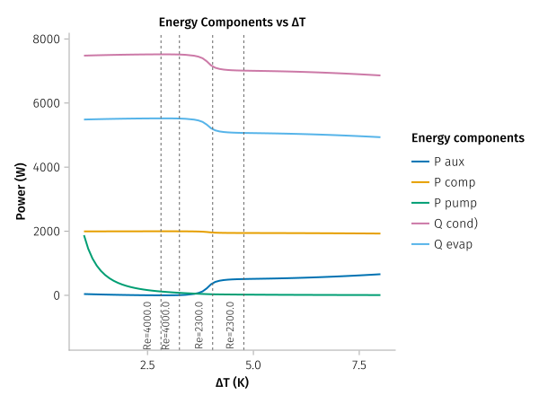
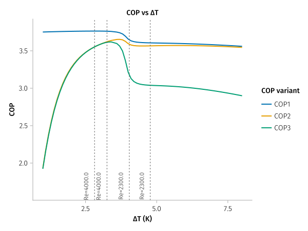
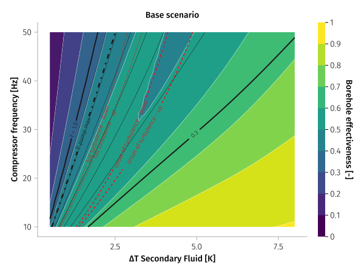
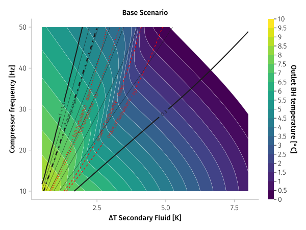

# Introduction

Ground source heat pumps (GSHPs) have emerged as essential technologies for decarbonizing the heating sector, offering superior energy efficiency compared to conventional heating systems by exploiting relatively stable underground temperatures. Central to maximizing the performance of these systems is the optimization of fluid flow rates through ground heat exchangers, which directly influences both system efficiency and operational costs.

However, current understanding of optimal flow control in GSHP systems remains fragmented across different system configurations and operational conditions. Most existing studies focus on either empirical optimization of specific installations or theoretical analysis of idealized systems, with limited integration between fundamental heat transfer principles and practical system constraints. Furthermore, the complex thermal-hydraulic coupling between heat pump performance, borehole heat exchanger effectiveness, and pump power consumption has not been systematically analyzed using physically-based models that can capture the nonlinear interactions between these subsystems.

To address these limitations, this study develops a comprehensive thermal-hydraulic model of GSHP systems that integrates detailed thermodynamic cycle analysis with borehole heat exchanger physics and pump hydraulics. Using the Julia ModelingToolkit ecosystem, we implement an equation-based modeling approach that enables simultaneous solution of all system equations while maintaining physical consistency across subsystem boundaries. Our analysis focuses on systems with direct hydraulic coupling between the heat pump and ground heat exchanger, representing a common configuration in residential and small commercial applications. Through parametric analysis of the coupled model, we identify fundamental relationships between flow rates, temperature differences, and system performance, providing insights that may inform both system design and control strategy development.

# Literature Review

<!-- MISSING CONTENT ANALYSIS:
1. FLOW REGIME MODELING: The paper focuses on laminar-turbulent transition but lacks coverage of transition modeling approaches, entry length effects, and regime classification methods specifically for BHE applications.
   - Need to cite: @salhein2022control (discusses optimal velocity ranges for different pipe diameters)
   - Consider: @delcol2014experimental (experimental flow boiling and transition effects)

2. PHYSICS-BASED BHE MODELS: Limited discussion of detailed thermal resistance networks, multipole method implementations, and analytical solutions for U-tube configurations that form the foundation for the thermal model used.
   - Need to cite: @claesson2018explicit (explicit multipole formulas for U-tube thermal resistance)
   - Need to cite: @Claesson2004 (plate heat exchanger modeling with flow regimes)

3. EXPERIMENTAL VALIDATION: Missing comprehensive experimental studies validating coupled thermal-hydraulic models under varying flow conditions, especially in transition regimes.
   - Need to cite: @li2024field (field test validation of GSHP systems)
   - Need to cite: @bordignon2024evaluation (long-term performance evaluation)
   - Need to cite: @benassi2015energy (experimental data on variable speed systems)

4. FLUID PROPERTY EFFECTS: Insufficient coverage of secondary fluid property impacts (viscosity, thermal conductivity, heat capacity) on optimal flow rates, particularly for antifreeze solutions.
   - Need to cite: @menegazzo2022state (discusses secondary fluids and nanofluids)
   - Need to cite: @karlsson2006capacity (capacity control with different fluids)

5. SYSTEM-LEVEL OPTIMIZATION: Limited discussion of simultaneous optimization across all subsystems (compressor frequency, pump speed, BHE sizing) and multi-objective approaches.
   - Need to cite: @ma2020recent (comprehensive review of design and control optimization)
   - Need to cite: @atam2015design (optimal design approaches)
   - Need to cite: @gao2016optimization (optimization of small-scale systems)
   - Need to cite: @ikeda2017optimization (multi-source operation optimization)

6. REAL-TIME CONTROL: Missing coverage of adaptive control strategies that can respond to changing ground conditions, seasonal variations, and system degradation.
   - Need to cite: @gao2022optimal (optimal control for thermal environment)
   - Need to cite: @zhou2024study (operation optimization with dynamic conditions)
   - Need to cite: @mu2015extremum (extremum seeking control)

7. ECONOMIC ANALYSIS: Limited treatment of life-cycle cost optimization and trade-offs between energy savings and parasitic pumping power from economic perspectives.
   - Need to cite: @mader2014capacity (total cost of ownership analysis)
   - Need to cite: @capozza2015long (long-term economic analysis)

8. FIELD PERFORMANCE: Insufficient data on long-term field performance validation of optimal flow control strategies across different climates and system configurations.
   - Need to cite: @li2024field (field test results and validation)
   - Need to cite: @somogyi2016scientific (European field performance review)
   - Need to cite: @cervera2016control (experimental one-year operation results)

9. HYBRID SYSTEMS: Limited coverage of GSHP integration with other renewable sources and storage systems where flow optimization becomes more complex.
   - Need to cite: @bordignon2024evaluation (dual-source heat pump evaluation)
   - Need to cite: @ikeda2017optimization (hybrid GSHP with multiple sources)

10. MODELING TOOLS: Incomplete review of available modeling frameworks, their capabilities, limitations, and suitability for different types of flow optimization studies.
    - Need to cite: @ma2020recent (review of modeling approaches)
    - Need to cite: @atam2015ground (modeling and control challenges)
    - Need to cite: @menegazzo2022state (state-of-art modeling tools)
-->

## Theoretical Foundations and Early Work

The theoretical foundations for optimal flow control in heat pump systems were established by Granryd [@granryd2010analytical], who derived analytical expressions for optimum flow rates in evaporators and condensers of heat pumping systems. This seminal work provided the mathematical framework for understanding how flow velocities on air or liquid sides significantly affect system performance, leading to design relations that maximize overall coefficient of performance (COP) by considering energy demands for compressors, pumps, and fans. Granryd's analytical approach demonstrated that optimal flow rates result from balancing increased heat transfer effectiveness against parasitic pumping power, establishing the theoretical basis for subsequent flow optimization research.

## Flow Control Optimization Studies

### Groundbreaking Control Strategies

Edwards and Finn [@edwards2015generalised] developed a groundbreaking control strategy for predicting optimal ground source heat pump water flow rates under part load operation. Their work demonstrated that optimal flow rates could be calculated from available design data and minimal on-line measurements, resulting in seasonal system performance (SPF3) improvements of 20-40% compared to nominal flow rate operation, particularly beneficial for the prevalent low-load conditions during heating and cooling seasons. The study established that optimal internal water flow rate decreases as part load decreases, while optimal external water flow rate remains relatively constant.

### Empirical Optimization Methodologies

Montagud et al. [@montagud2013situ] developed a comprehensive in situ experimental methodology for optimizing water circulation pump frequencies in GSHP systems. Their three-step approach, involving experimental characterization, quasi-steady state performance mapping, and extrapolation to partial load conditions, demonstrated potential annual energy savings of up to 28%. This methodology was subsequently extended by Cervera-Vázquez et al. [@cervera2014situ] to multistage heat pump units, achieving even higher energy savings of up to 32% through optimized pump frequency control.

Zarrella et al. conducted a comprehensive simulation-based analysis of variable flow pumping in ground source heat pump systems with different types of borehole heat exchangers. Their study compared constant speed circulation pumps with variable flow controlled by maintaining constant temperature difference across the heat pump on the ground side. The analysis revealed that while constant speed pumps provided better heat pump energy performance, variable flow control with constant temperature difference offered optimal system-wide efficiency when considering parasitic pumping energy.

### Advanced Control Algorithms

De Ridder et al. [@de2011optimal] presented an optimal control algorithm for borehole thermal energy storage systems using dynamic programming techniques. Their approach successfully managed system constraints while minimizing operation costs, demonstrating robustness across various weather scenarios. The study highlighted the importance of thermal storage management in optimizing overall system performance.

Mu et al. introduced extremum seeking control (ESC) for efficient operation of hybrid ground source heat pump systems. Their self-optimizing control scheme eliminated the need for detailed plant models by using feedback of total power consumption and control inputs of relative flow rate and pump speed. The ESC approach achieved nearly optimal efficiency without requiring extensive system modeling, representing a significant advancement in model-free optimization methods.

## Variable Speed Systems and Advanced Technologies

Benassi and Mantovan [@benassi2015energy] conducted comprehensive experimental and modeling studies of a GSHP system with variable speed compressor, water pumps, and fans. Their work established that at higher load ratios, maximum COP3 is obtained for a water temperature difference of about 5K at the condenser and 2.8K at the evaporator, while at partial loads, maximum efficiency is achieved at minimum water flow rates to both borehole heat exchangers and building circuits due to heat exchanger oversizing. The study demonstrated potential for 30% improvement in seasonal COP when using brushless DC motor compressors instead of inverter-driven asynchronous motors.

The economic viability of variable speed control was analyzed by Mader and Madani [@mader2014capacity], who compared variable speed versus on/off control in air-water heat pumps across different climate zones. Their total cost of ownership analysis found that variable speed control becomes increasingly profitable in colder climates, with potential savings of up to 5000 EUR over 15 years of operation compared to on/off control.

## System Integration and Modeling

Corberán et al. [@corberan2010quasi] presented a quasi-steady state mathematical model of an integrated GSHP system for building space control. Their validated model revealed that higher water return temperatures reduce heat pump ON time operation and result in approximately 5% increase in daily heat pump seasonal performance factor per degree increase in building water return temperature. The study emphasized the critical importance of considering building circuit variables in overall system performance optimization.

Beaudry et al. [@beaudry2022flow] investigated flow rate control in standing column wells, showing that variable flow rate control maintaining a 2°C temperature difference across the plate heat exchanger can generate 8-11% annual energy savings while reducing groundwater usage. This work extended flow optimization concepts to specialized GSHP configurations with groundwater interaction.

## Comprehensive Reviews and Recent Developments

### Modeling and Control Reviews

Atam and Helsen [@atam2015ground] provided a comprehensive two-part review of modeling and optimal control challenges in ground-coupled heat pump systems. Their analysis highlighted that mathematical model-based control approaches achieve performance within 10% of dynamic programming-based optimal control. However, they identified control-oriented borefield modeling as a critical bottleneck, particularly for predicting thermal behavior accounting for thermal interaction between boreholes, groundwater flow effects, and multi-layer ground characteristics.

### Recent Advances in Design and Control

A comprehensive review of recent advances and developments in optimal design and control of ground source heat pump systems covered emerging trends in system design, advanced control strategies, and integration with renewable energy sources, providing a current perspective on the state of GSHP optimization research.

### AI and Autonomous Control

Recent work has reviewed advanced ground source heat pump control approaches focusing on artificial intelligence for autonomous and adaptive control. This analysis highlighted the growing importance of machine learning and AI-based methods for handling the complexity of GSHP system optimization under varying operational conditions and long-term ground thermal evolution.

## Long-term Performance Analysis

Capozza et al. [@capozza2015long] conducted extensive analysis of two GSHP systems using validated numerical models, proposing optimization strategies for operating parameters. Their work emphasized the importance of considering seasonal variations and long-term ground thermal evolution in control strategy development, demonstrating that short-term optimization strategies may not be optimal over the system's operational lifetime.

## Research Gaps and Current Limitations

Despite significant progress in GSHP flow control optimization, several critical gaps remain in the current literature:

1.  **Integration of detailed physics-based models**: Most optimization studies rely on empirical correlations or simplified models that may not capture the full complexity of thermal-hydraulic coupling in GSHP systems.

2.  **Comprehensive system-level optimization**: While individual components have been optimized separately, few studies address the simultaneous optimization of all subsystem interactions including refrigerant cycle, borehole heat exchanger, and pumping system.

3.  **Validation under realistic conditions**: Many theoretical studies lack validation against real system performance data under varying operational conditions and system configurations.

4.  **Generalizability across system types**: Most studies focus on specific system configurations, limiting the applicability of findings to broader GSHP system designs.

The present study addresses these gaps by developing a comprehensive thermal-hydraulic model that couples detailed thermodynamic cycle analysis with borehole heat exchanger physics and pump hydraulics, enabling systematic investigation of optimal flow control strategies across different system configurations and operating conditions.

# Methods

## Modeling Framework Selection

The complexity of GSHP systems has necessitated careful selection of modeling tools and frameworks. Various options exist, each with distinct advantages and limitations:

**EES (Engineering Equation Solver)** represents the traditional approach to heat pump cycle modeling, offering rapid setup of steady-state vapor compression cycles with extensive built-in refrigerant property databases. While excellent for teaching and quick optimization studies, EES is primarily limited to steady-state analysis and lacks detailed borehole heat exchanger models.

**Modelica Ecosystem** tools, including commercial solutions like Modelon VCL and TIL Suite, as well as open-source libraries such as ThermoCycle, Buildings, and AixLib, provide sophisticated moving-boundary heat exchanger models with geometry-based heat transfer coefficient and pressure drop correlations. However, commercial libraries come with significant licensing costs and proprietary restrictions.

**TRNSYS with Type 557 (DST)** has established itself as a standard tool for building and ground source heat pump studies, particularly excelling in seasonal GSHP simulations, though it relies on lumped/empirical cycle models rather than detailed moving-boundary heat exchanger physics.

**Python-based tools** have emerged as popular open-source alternatives, with CoolProp providing thermophysical properties, TESPy enabling process modeling for steady-state heat pump cycles, and pygfunction offering state-of-the-art borefield modeling capabilities.

We decided to implement the model from scratch using ModelingToolkit.jl. This ecosystem exists as part of the Julia programming language and is similar in principle to Modelica: an acausal component-based framework. Key reasons for this choice include: free and open source nature, excellent symbolic computation capabilities, and seamless integration with advanced optimization and machine learning ecosystems.

## System Model Architecture

The GSHP system model consists of three coupled submodels that are solved together: thermodynamic cycle (thermal system), borehole heat exchanger, and pump hydraulics (hydraulic system). The steady-state system is solved using ModelingToolkit.jl with symbolic manipulation and NonlinearSolve.jl library for the solvers.

The model implementation prioritizes modularity and extensibility, allowing for easy modification of individual components while maintaining system-level coupling consistency. The thermal-hydraulic separation enables efficient parameter studies and optimization while ensuring physical consistency through the coupling interface. The model architecture employs a modular approach typical of ModelingToolkit, where fundamental components such as thermophysical properties are defined first and then used to build parent components like the pump and compressor. Both the thermal and hydraulic models are coupled through mass flow (the secondary fluid mass flow from the thermal system sets the design flow for the hydraulic system), temperature (borehole inlet/outlet temperatures link the thermal and hydraulic properties), and performance feedback (pump power from the hydraulic system feeds into overall system KPIs). The solution strategy follows a sequential approach: first, the thermodynamic cycle is solved for given boundary conditions; next, mass flows, temperatures, and thermal loads are extracted; then, the hydraulic system is solved using these outputs as boundary conditions; finally, thermal and hydraulic results are combined to compute overall system performance metrics, including auxiliary heating requirements if the heat pump capacity is insufficient.

### Thermophysical properties:

Clapeyron.jl and EntropyScaling are used for determining the properties of the refrigerant. CoolProp correlations are used for the secondary fluid.

### Thermodynamic Cycle:

The thermodynamic cycle implements a R134A cycle with the following components:

#### Evaporator:

A moving-boundary plate heat exchanger evaporator with dynamically allocated regions for two-phase evaporation and single-phase superheating. The model features:

-   **Geometric modeling**: Chevron plate geometry with adjustable plate spacing (b), number of plates (np), width (W), enlargement factor (ϕ), and chevron angle (β)
-   **Two-zone heat transfer**: The evaporator length is split between evaporation and superheating zones. The fraction of the HX occupied by each zone is a variable.
-   **Heat transfer correlations**:
    -   Two-phase region: Amalfi correlation for convective boiling in plate heat exchangers (avergaed ovr a vapor quality range)
    -   Superheating region: Martin correlations for single-phase plate heat exchanger flow with laminar-turbulent (smooth) transition
-   **Boundary conditions**: Fixed superheat degree (ΔTSH) and secondary fluid temperature difference (ΔTSF) as control variables

The smooth transition is necessary for the solver to

-   **Friction**: Darcy-Weisbach equations with smooth transition between laminar and turbulent regimes using error function blending
-   **Friction factor**: Enhanced Colebrook-White correlations
-   **Heat exchanger losses**: Chevron-plate correlations based on Martin's work for pressure drop in plate heat exchangers

#### Compressor:

The compressor model incorporates:

1.  **Volumetric displacement**: Fixed displacement volume with frequency-controlled capacity -

2.  **Isentropic efficiency**: Constant isentropic efficiency

#### Expansion Valve:

Modeled as an isenthalpic expansion process. A constraint imposed in the solver is the superheating degree.

#### Condenser:

Simplified model assuming constant condensing temperature and specified subcooling degree (ΔTSC). The detailed condenser heat transfer is not modeled, focusing on the evaporator side.

### Borehole Heat Exchanger:

The U-tube grouted borehole is simulated by two different models:

#### Thermal: {#sec-method_thermal}

-   **Analytical solution**: Uses eigenvalue decomposition of coupled 1D ODEs to solve the temperature profiles along the borehole depth
-   **Multipole method**: For the grout resistance, we implement thermal resistance calculations between pipes and to the borehole wall using multipole approximations for complex geometry effects **ref needed**
-   **Heat transfer coefficients**: Derived from the borehole geometry and dynamical fluid properties
-   **Boundary conditions**: Uniform borehole wall temperature as the thermal boundary condition
-   **Temperature profiles**: Analytical expressions for fluid temperatures in both legs as functions of depth

#### Hydraulic:

The borehole thermal model is connected to the hydraulic system through temperature-dependent fluid properties.

-   **Pipe friction**: Darcy-Weisbach equations with smooth transition between laminar and turbulent regimes using smooth blending (erf)
-   **Friction factor**: Enhanced Colebrook-White correlations with automatic regime detection
-   **Component-wise pressure drops**: Individual calculation for each system component (evaporator, borehole, connecting pipes)

## Pump

Since the hydraulic mode is decoupled from the thermal model, there is no feedback from hydraulic losses to the thermal model, which is a limitation that affects the high flow simulations. In reality, better performances are expected in reality thanks to the added heat in the heat source loop, both because of electrical losses as well as the conversion of work into heat due to frictional losses.

### Pump Performance:

The centrifugal pump follows dimensionless performance curves based on affinity laws:

-   **Head coefficient**: $\psi = \psi_0 - K \cdot \varphi^2$ where $\varphi$ is the flow coefficient

-   **Efficiency**: $\eta = \eta_{\text{max}} \left(1 - \left(\frac{\varphi - \varphi_{\text{BEP}}}{\varphi_{\text{BEP}}}\right)^2\right)$ with parabolic efficiency curve around the best efficiency point (BEP)

-   **Power calculation**: Electrical power including motor efficiency

## Performance Metrics:

The model calculates multiple performance indicators:

-   **Thermal COP**: $COP_1 = \frac{\dot{Q}_{evap}}{W_{comp}}$ (refrigeration cycle only)
-   **System COP**: $COP_2 = \frac{\dot{Q}_{evap}}{W_{comp} + P_{pump}}$ (including pump power)
-   COP 3 (includes auxiliary heating)

### Numerical Implementation:

-   **Symbolic computation**: Full symbolic derivation of equations using ModelingToolkit.jl
-   **Robust solvers**: Multiple nonlinear solver options including RobustMultiNewton and TrustRegion methods
-   **Automatic differentiation**: Forward-mode AD for enhanced convergence properties
-   **Continuation methods**: Built-in parameter sweep capabilities with automatic stepping and convergence control

*Detailed system parameters and correlations are provided in @sec_appendix_modelling.*

# Results:

## Test case

The test case represents a typical Swedish GSHP installation. The system features a 250m deep borehole with a 40mm outer diameter polyethylene single U-tube collector. Complete technical specifications and thermal properties are detailed in Appendix A.

<!--  # KPIs

To establish baseline performance characteristics, we initially examine a fundamental question: what constitutes the optimal rule-based control strategy under standard operating conditions?
-->

## \delta T influence

As a first step, we'll look at the effect of the main operating parameter: \Delta T on the overall process in order to gain a better understanding of the effects at play.

::: {#fig-pannel_1d layout-ncol=2}

{#fig-res_1d}

{#fig-bh_eff_1d}

{#fig-temp_1d}

{#fig-energy_1d}

:::

Figure @fig-pannel_1d shows us the different effects contributing to the GSHP overall performance. The x axis represents the temperature difference accross the BHE (equivalently, accross the PHX since we neglect the pump effect on temperature). On each figure, the flow transition has been represented by vertical lines. Since we chose a smooth transition in the mdoelling, there are 2 such vertical lines for each leg. In this simulation, heat is extracted from the bortehole, therefore leg 1 is colder than leg 2. In addition to this temeprature difference between the 2 legs, the fact that the SF is more viscous at lower temperatures leads to a transition at lower mass flow for leg 1 (respectively at higher \delta T).

<!-- The reason is that  - since we are considering extraction, - leg 1 is colder than leg 2, leading to a higher viscosity, therefore a transition at higher mass flow (lower delta t).-->

Starting with @fig-res_1d, the y axis represents the thermal resistances between different regions fo teh BHE. Rp1,2 is for example the thermal resistance in the grout (calculated according to @#sec-method_thermal) between leg 1 and 2. The f subscript denotes the includion of the convective (fluid) resistance. So, on the graph, the grout resistance is unaffected by the flow, but the total resistance presents a clear transition with respect to the flow type. The shape of the transition is similar to the blending funciton chosen for the transition regime, which was expected. At low delta T, the rersistance is more imporrtant. Another aspect visible on the figure is that the transition order between leg 1 and 2 also affects the resistances in a given order.

@fig-bh_eff_1d displays the borehole heat exchanger (BHE) efficiency, defined as: $$
1 - \frac{T_{\text{out}} - T_{\text{wall}}}{T_{\text{in}} - T_{\text{wall}}}
$$ {#eq_efficiency}

The borehole efficiency increases with \Delta T, but a local minimum occurs right at the limit of the laminar region, as a result of both the mass flow itself and the effect of the resistance (as seen in @fig-res_1d).

@fig-temp_1d shows the different temperatures in the sysem. The 1D analysis was carried out with constant BHE wall temperature. It is the horizontal line at T = 10C at the top. Then, looking at the BHE temperatures - denoted with (b) - an overall trend appears: the higher the \delta t, the lower the temperaturers in the BHE. Focusing on the Schematically, this better efficiency leads to higher evaporation temperature:

Finally, @fig-energy_1d shows the result on the different capacities in the system. The colder evaporation temperature at higher delta T leads to a reduced refrigerant mass flow and therefore reduced condensation and evaporation capacities. The compresssor electrical power is relatively flat accross the range. In addition to these thermodynamic metrics, the pumping power is also represented. At low delta T, the high flow leads to a sharp increase of pumping power. The last capacity represented is the auxiliary capacity. It has been calculated by taking the maximum condenser capacity as the reference. If the delivered capacity was lower than this rerference, then auxiliary (Joule) heating was added in order to reach the same capacity. 

{#fig-cop_1d}

COP1 is the COP taking into account neither the pumpinng power nor the auxiliray heating. COP2 acconts for the pumping power. In turn, fr this 1D analysis, The COP3 is calculated including both pumping power and auxiliary heating.

@fig-cop_1d shows a clear COP3 peak around \Delta T = 3K. This is in line with the standard practice accross the field. However, this is a very partial view of the system, many more factors affect the shape of this curve and where the optimal lies.

### Partial load

## Robustness

The previous section focused on one particular design in one particular range of operating conditions. However, due to the multiple thermophysical effects contributing to the overall system behaviour, conclusions such as "$\Delta T = 3\,\mathrm{K}$" are difficult to trust. In this section, we expand the analysis to a new axis: compressor frequency. The goal is to provide a better picture of the system.

The simulations have been set up similarly to the 1D case, except that the compressor speed has been varied between 30\% and 100\% (in this case XX Hz and YY Hz). The superheating degree imposed by the expansion valve is kept constant throughout.

In the next figures, different system-related metrics have been overlaid in addition to the KPI under focus:

- Pump speed isolines

- Maximum electric pump power

- Transition boundaries

@fig-pure_water_cop3 is a contour plot representing a 2d parametric exploration. The x axis is the set delta T for the secondary fluid. The ordinates represent the compressor frequency. The contours represent the COP 3(f), calculated as so: Thjis COP3 is calculated for a given fgrequency, The maximum condenser heat that the HP can deliver at this frequency and then the necessary auxiliary heating to match it is added. It's a way to quantify the efficiency of the system while not having to chose a target Q cond.

On the diagram, several isolines are represented:

-   The iso pump speed are represented in black. The 30% and 100% speeds are represented in thick and each 10% step in between is a thiner line. Beyond these two boundaries, the physical system can actually not be operated.

-   Similarily, the maximum electrical power is also represented by such a line (dashed black). The operative envelope is also constrained by this additional parameter.

-   The different kaminar to turbulent transitions of each legs of the BHE are represented by the onset and full transition iso rteynolds number (2300 and 4000).

In order to better visualize these ridges, we have calculated a relatrive COP 3 deficit for a given compressor frequency. NEEDS explanation

The ridge line in red corresponds to the location of this maximum used for the auxiliary heating calculation. The ridge line presents 2 regions:

-   In the ttop part, there is a clear ridge

-   In the bottom part, a hockey stick ridge is present

In the lower region, the behaviour of the system is dominated by the high borehole efficiency. In the top, the relative increase of pumpng power is justified: it allows achieveing turbulence in the collector, and therefore better BH efficiency. Conversely, achieveing turbulence at low compressor speed is not worth the extra pumping power. In some sense, achiveing turbulence is "having a high speed", regardless of the thermal load.

This second region is often not reachable in the base scenario: the pump minimum speed being too high and therefore does not allow for a low enough SF flow.

When

::: {#fig-pannel_2d layout-ncol=2}

{#fig-res_2d}

{#fig-bh_eff_2d}

:::

{#fig-bh_eff_2d}

In @fig-strategies, several typical strategies have been represented, as they would occur on the base scenario.

-   Constant Delta T: vertical lines, black

-   Constant pressure drop: red

-   Constant pump speed: orange

-   Constant compressor speed to pump speed ratio: blue

-   Constant mass flow ratio: pink% could also be devised (however in practice sensors are never installed for cost effieicncy reaspons. Maybe a s

By comparing the 

Conslusion is that nothing seems to be able to capture the complex interplay of the different effects.

Lookking at the graph, the

NEW GRAOH AT DIFFERENT T WALL

The figure XX shows that the ridge

## Additional scenarios

3 additional scenarios have been simulated with one difference for each variant:

-   "Cold wall", T wall is set to 5C instead of 10C

-   "Pure Water", the secondary fluid is pure water

%-   "Bigger pipes", the OD of the collector pipes is set to 40 instead of 32mm

-   "Longer collector", the collector is 200m instead of 150m

@fig-pannel_variants_COP2_3 rerprersents the COP2 for each variant. On this graph, we can see the position of the optimal COP3 for different loads.

%Focusing on the position of the ridge, one can see that, in the colder wall collector scenario, there seems to be a moment where switching the pump to the minimum in order to take advantage of the increased BH efficiency instead of wasting the pumping power trying to achieve turbulence in the collector.

It is important to remember the model's assumptions when discussing these aspects. In the transition region, the behaviour is somewhat unclear. There is some entry length effect that happen in reality, the temperature is not unform in each leg (-\> some part of the same leg can be turbulent while the other is laminar). Regardless of these limitations, it does seem that the optimal flow is "right after the transition". However, as discussed, the classic rule based control strategies can not track this transition point in a satifactory manner.

# Conclusions

It seems that the widespread rule based controll perform decently in the test case, however, it remains to be seen if the same heuristic does as well when it comes to eg. coaxial BHE. We suggest that the models be leveraged in order to produce better heuristics.

## Nomenclature

### Symbols

**Geometric Parameters:** - $D$ = Impeller diameter \[m\] - $D_{bh}$ = Borehole diameter \[m\]\
- $D_{pipe,i}$ = Pipe inner diameter \[m\] - $D_{pipe,o}$ = Pipe outer diameter \[m\] - $H$ = Pump head \[m\] - $L$ = Plate length \[m\] - $L_b$ = Borehole depth \[m\] - $N_{plates}$ = Number of plates \[-\] - $W$ = Plate width \[m\] - $b$ = Channel spacing \[m\] - $s$ = Shank spacing \[m\] - $t_{pipe}$ = Pipe wall thickness \[m\] - $t_{plate}$ = Plate thickness \[m\]

**Thermophysical Properties:** - $\lambda$ = Thermal conductivity \[W/(m·K)\] - $\rho$ = Density \[kg/m³\] - $\chi$ = Mass fraction \[-\] - $\beta$ = Chevron angle \[rad\] - $h$ = Specific enthalpy \[kJ/kg\]

**Flow and Transport Variables:** - $\dot{V}$ = Volumetric flow rate \[m³/s\] - $\dot{m}$ = Mass flow rate \[kg/s\] - $\dot{Q}$ = Heat transfer rate \[W\] - $N$ = Rotational speed \[rpm\] - $P$ = Pressure \[bar, Pa\] - $T$ = Temperature \[K, °C\] - $\Delta T$ = Temperature difference \[K\]

**Dimensionless Parameters:** - $\phi$ = Flow coefficient, $\dot{V}/(N \cdot D^3)$ \[-\] - $\psi$ = Head coefficient, $g \cdot H/(N^2 \cdot D^2)$ \[-\] - $\psi_0$ = Shutoff head coefficient \[-\] - $K$ = Head curve slope parameter \[-\]

**Performance Parameters:** - $COP$ = Coefficient of performance \[-\] - $W$ = Work/Power \[W\] - $\eta$ = Efficiency \[-\] - $f$ = Frequency \[Hz\] - $g$ = Gravitational acceleration \[m/s²\]

### Subscripts

-   $BEP$ = Best efficiency point
-   $comp$ = Compressor
-   $elec$ = Electrical
-   $evap$ = Evaporator
-   $grout$ = Grout material
-   $high$ = High pressure side
-   $in$ = Inlet condition
-   $is$ = Isentropic
-   $max$ = Maximum
-   $motor$ = Motor
-   $out$ = Outlet condition
-   $pipe$ = Pipe material
-   $plate$ = Plate material\
-   $pump$ = Pump
-   $ref$ = Refrigerant
-   $s$ = Isentropic condition
-   $shaft$ = Shaft
-   $soil$ = Soil/ground
-   $wall$ = Wall condition

### Abbreviations

-   $BHE$ = Borehole Heat Exchanger
-   $COP$ = Coefficient of Performance\
-   $GSHP$ = Ground Source Heat Pump
-   $MEA$ = Monoethanolamine
-   $OD$ = Outer Diameter
-   $ID$ = Inner Diameter
-   $PE$ = Polyethylene
-   $SC$ = Subcooling
-   $SF$ = Secondary Fluid
-   $SH$ = Superheating

### Chemical Notation

-   $R134A$ = 1,1,1,2-Tetrafluoroethane (refrigerant)
-   $MEA$ = Monoethanolamine ($C_2H_7NO$)

## Appendix A: Model Parameters and Technical Specifications {#sec_appendix_modelling}

### A.1 Borehole Heat Exchanger Specifications

**Geometric Parameters:** - Borehole depth: $L_b = 250$ m - Pipe outer diameter: $D_{pipe,o} = 32$ mm - Pipe inner diameter: $D_{pipe,i} = 28.24$ mm - Pipe wall thickness: $t_{pipe} = 1.88$ mm - Borehole diameter: $D_{bh} = 115$ mm - Shank spacing: $s = 75$ mm

**Thermal Properties:** - Pipe thermal conductivity: $\lambda_{pipe} = 0.4$ W/(m·K) - Grout thermal conductivity: $\lambda_{grout} = 1.5$ W/(m·K) - Ground thermal conductivity: $\lambda_{soil} = 2.0$ W/(m·K) - Boundary condition: $T_{wall} = 283.15$ K (constant)

### A.2 Heat Pump System Parameters

**Working Fluids:** - Primary refrigerant: R134A - Secondary fluid: MEA aqueous solution with mass fraction $\chi = 0.28$

**Compressor Specifications:** - Isentropic efficiency: $\eta_{is} = 0.7$ - Operating frequency: $f = 50$ Hz - Electrical motor efficiency: $\eta_{motor} = 0.9$

### A.3 Plate Heat Exchanger (Evaporator) Specifications

**Geometric Parameters:** - Number of plates: $N_{plates} = 20$ - Plate width: $W = 0.1$ m - Plate length: $L = 0.3$ m - Channel spacing: $b = 1.5$ mm - Chevron angle: $\beta = \pi/6$ rad $(30°)$ - Plate thickness: $t_{plate} = 0.5$ mm - Plate thermal conductivity: $\lambda_{plate} = 16$ W/(m·K)

### A.4 Operating Conditions (test_GSHP Reference Case)

**Temperature Differences:** - Secondary fluid temperature difference: $\Delta T_{SF} = 3.5$ K - Superheating temperature difference: $\Delta T_{SH} = 7$ K - Subcooling temperature difference: $\Delta T_{SC} = 5$ K

**Pressure Conditions:** - High-side pressure: $P_{high} = 14$ bar - Secondary fluid mass fraction: $\chi = 0.28$

### A.5 Mathematical Correlations

**A.5.1 Pump Performance:** - Dimensionless head coefficient: $$\psi = \psi_0 - K \cdot \phi^2$$

-   Dimensionless flow coefficient: $$\phi = \frac{\dot{V}}{N \cdot D^3}$$

-   Dimensionless head coefficient: $$\psi = \frac{g \cdot H}{N^2 \cdot D^2}$$

-   Pump efficiency: $$\eta_{pump} = \eta_{max} \left(1 - \left(\frac{\phi - \phi_{BEP}}{\phi_{BEP}}\right)^2\right)$$

where $N$ is rotational speed \[rpm\], $D$ is impeller diameter \[m\], $\dot{V}$ is volumetric flow rate \[m³/s\], $H$ is pump head \[m\], $\eta_{max}$ is maximum efficiency, and $\phi_{BEP}$ is flow coefficient at best efficiency point.

**A.5.2 Power Consumption:** - Shaft power: $$P_{shaft} = \frac{\rho \cdot g \cdot \dot{V} \cdot H}{\eta_{pump}}$$

-   Electrical power: $$P_{elec} = \frac{P_{shaft}}{\eta_{motor}}$$

**A.5.3 Compressor Work:** - Isentropic compression work: $$W_{comp} = \dot{m}_{ref} \cdot \frac{h_{out,s} - h_{in}}{\eta_{is}}$$

where $\dot{m}_{ref}$ is refrigerant mass flow rate \[kg/s\], $h_{in}$ and $h_{out,s}$ are inlet and isentropic outlet specific enthalpies \[kJ/kg\], respectively.

**A.5.4 Coefficient of Performance:** - Thermal COP: $$COP_1 = \frac{\dot{Q}_{evap}}{W_{comp}}$$

-   System COP: $$COP_2 = \frac{\dot{Q}_{evap}}{W_{comp} + P_{pump}}$$

where $\dot{Q}_{evap}$ is evaporator heat transfer rate \[W\].