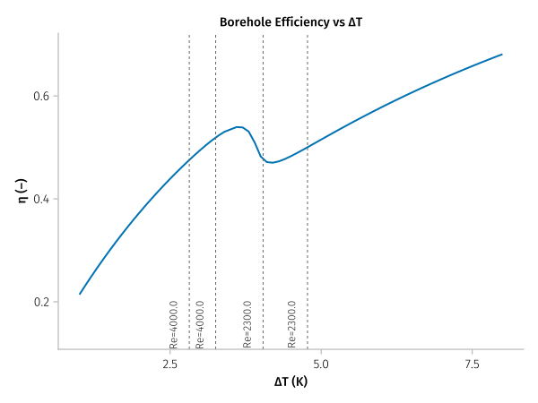
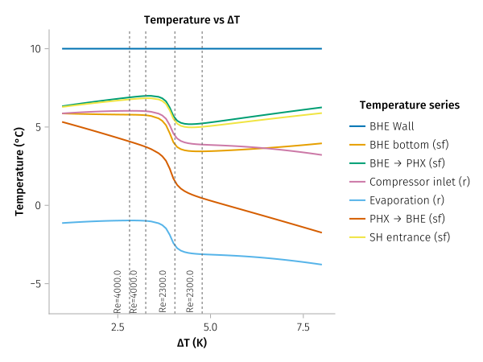
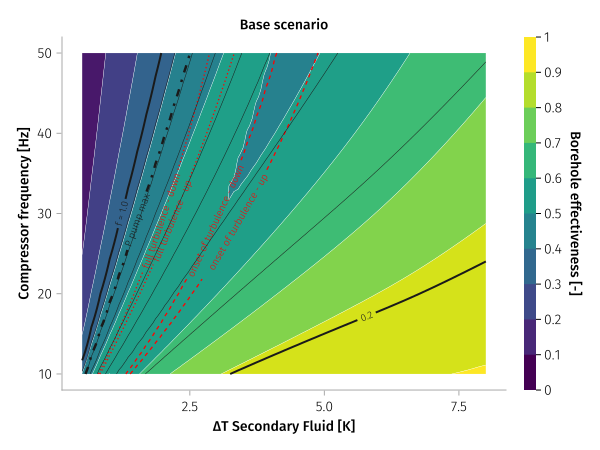
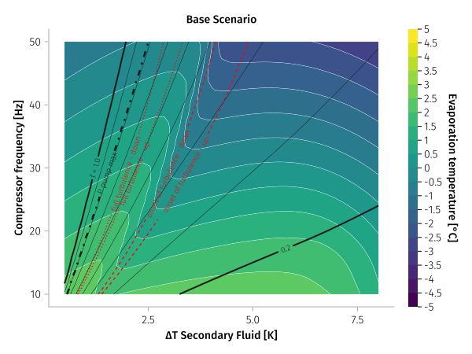
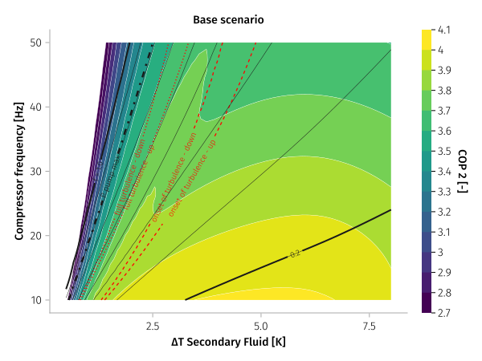
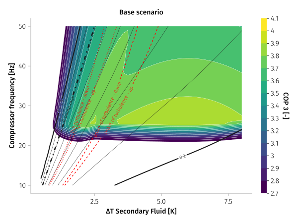
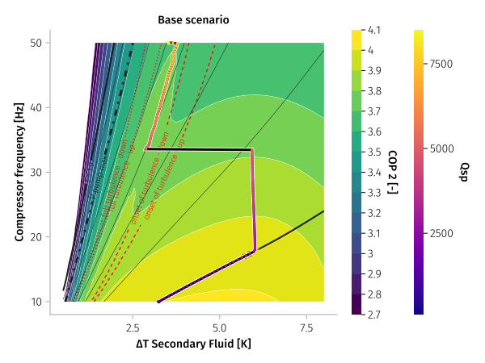
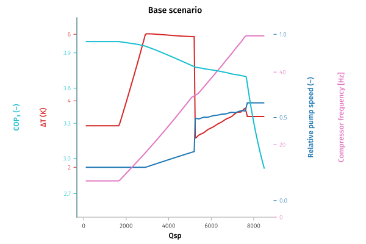
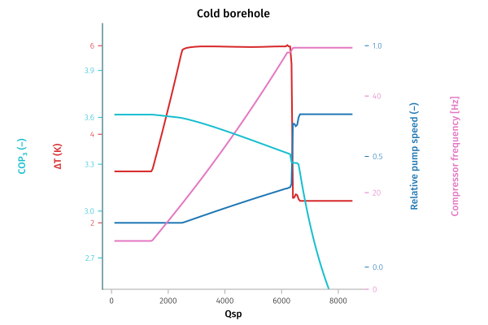
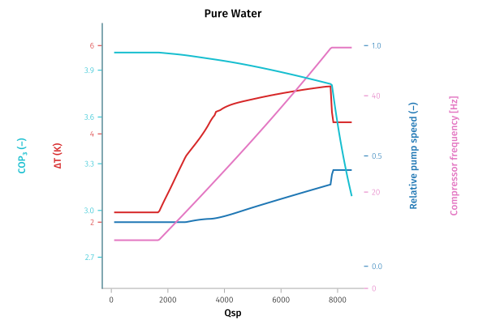

# Introduction

<!-- FEEDBACK: Strong opening paragraph that clearly establishes the importance and context. Good use of technical terminology. Consider adding a brief quantitative statement about the energy efficiency gains possible. -->

Ground source heat pumps (GSHPs) have emerged as essential technologies for decarbonizing the heating sector, offering superior energy efficiency compared to conventional heating systems by exploiting relatively stable underground temperatures. Central to maximizing the performance of these systems is the optimization of fluid flow rates through borehole heat exchangers (BHE), which directly influences both system efficiency therefore operational costs.

<!-- FEEDBACK: Good problem identification paragraph. The phrase "fragmented across different system configurations" could be more specific - what exactly is fragmented? Consider mentioning specific gaps in knowledge more clearly. -->

However, current understanding of optimal flow control in GSHP systems remains fragmented across different system configurations and operational conditions. Most existing studies focus on either empirical optimization of specific installations or theoretical analysis of idealized systems, with limited integration between fundamental heat transfer principles and practical implementations. Furthermore, the complex thermal-hydraulic coupling between heat pump performance, borehole heat exchanger effectiveness, and pump power consumption has not been systematically analyzed using physically-based models that can capture the nonlinear interactions between these subsystems.

<!-- FEEDBACK: Excellent paragraph that clearly states your contribution and approach. The sentence structure is good, though the second sentence is quite long - consider breaking it up for readability. Good use of technical terms like "equation-based modeling approach" and "subsystem boundaries." -->

To address these limitations, this study develops a comprehensive thermal-hydraulic model of GSHP systems that integrates detailed thermodynamic cycle analysis with BHE physics and pump hydraulics. Using the Julia ModelingToolkit ecosystem, we implement an equation-based modeling approach that enables simultaneous solution of all system equations. Our analysis focuses on systems with direct hydraulic coupling between the heat pump and ground heat exchanger, a configuration common in residential and small commercial applications. The main scenario is defined to reflect typical Swedish GSHP installations. Through parametric analysis of the coupled model, we identify fundamental relationships between flow rates, temperature differences, and system performance, providing insights that may inform both system design and control strategy development.

# Literature Review

<!-- MISSING CONTENT ANALYSIS:
1. FLOW REGIME MODELING: The paper focuses on laminar-turbulent transition but lacks coverage of transition modeling approaches, entry length effects, and regime classification methods specifically for BHE applications.
   - Need to cite: @salhein2022control (discusses optimal velocity ranges for different pipe diameters)
   - Consider: @delcol2014experimental (experimental flow boiling and transition effects)

2. PHYSICS-BASED BHE MODELS: Limited discussion of detailed thermal resistance networks, multipole method implementations, and analytical solutions for U-tube configurations that form the foundation for the thermal model used.
   - Need to cite: @claesson2018explicit (explicit multipole formulas for U-tube thermal resistance)
   - Need to cite: @Claesson2004 (plate heat exchanger modeling with flow regimes)

3. EXPERIMENTAL VALIDATION: Missing comprehensive experimental studies validating coupled thermal-hydraulic models under varying flow conditions, especially in transition regimes.
   - Need to cite: @li2024field (field test validation of GSHP systems)
   - Need to cite: @bordignon2024evaluation (long-term performance evaluation)
   - Need to cite: @benassi2015energy (experimental data on variable speed systems)

4. FLUID PROPERTY EFFECTS: Insufficient coverage of secondary fluid property impacts (viscosity, thermal conductivity, heat capacity) on optimal flow rates, particularly for antifreeze solutions.
   - Need to cite: @menegazzo2022state (discusses secondary fluids and nanofluids)
   - Need to cite: @karlsson2006capacity (capacity control with different fluids)

5. SYSTEM-LEVEL OPTIMIZATION: Limited discussion of simultaneous optimization across all subsystems (compressor frequency, pump speed, BHE sizing) and multi-objective approaches.
   - Need to cite: @ma2020recent (comprehensive review of design and control optimization)
   - Need to cite: @atam2015design (optimal design approaches)
   - Need to cite: @gao2016optimization (optimization of small-scale systems)
   - Need to cite: @ikeda2017optimization (multi-source operation optimization)

6. REAL-TIME CONTROL: Missing coverage of adaptive control strategies that can respond to changing ground conditions, seasonal variations, and system degradation.
   - Need to cite: @gao2022optimal (optimal control for thermal environment)
   - Need to cite: @zhou2024study (operation optimization with dynamic conditions)
   - Need to cite: @mu2015extremum (extremum seeking control)

7. ECONOMIC ANALYSIS: Limited treatment of life-cycle cost optimization and trade-offs between energy savings and parasitic pumping power from economic perspectives.
   - Need to cite: @mader2014capacity (total cost of ownership analysis)
   - Need to cite: @capozza2015long (long-term economic analysis)

8. FIELD PERFORMANCE: Insufficient data on long-term field performance validation of optimal flow control strategies across different climates and system configurations.
   - Need to cite: @li2024field (field test results and validation)
   - Need to cite: @somogyi2016scientific (European field performance review)
   - Need to cite: @cervera2016control (experimental one-year operation results)

9. HYBRID SYSTEMS: Limited coverage of GSHP integration with other renewable sources and storage systems where flow optimization becomes more complex.
   - Need to cite: @bordignon2024evaluation (dual-source heat pump evaluation)
   - Need to cite: @ikeda2017optimization (hybrid GSHP with multiple sources)

10. MODELING TOOLS: Incomplete review of available modeling frameworks, their capabilities, limitations, and suitability for different types of flow optimization studies.
    - Need to cite: @ma2020recent (review of modeling approaches)
    - Need to cite: @atam2015ground (modeling and control challenges)
    - Need to cite: @menegazzo2022state (state-of-art modeling tools)
-->

## Theoretical Foundations and Early Work

<!-- FEEDBACK: Good historical context paragraph. The technical content is solid. Consider mentioning the year more prominently and perhaps adding a sentence about how this work influenced subsequent research. -->

The theoretical foundations for optimal flow control in heat pump systems were established by Granryd [@granryd2010analytical], who derived analytical expressions for optimum flow rates in evaporators and condensers of heat pumping systems. This seminal work provided the mathematical framework for understanding how flow velocities on air or liquid sides significantly affect system performance, leading to design relations that maximize overall coefficient of performance ($\text{COP}$) by considering energy demands for compressors, pumps, and fans. Granryd's analytical approach demonstrated that optimal flow rates result from balancing increased heat transfer effectiveness against parasitic pumping power, establishing the theoretical basis for subsequent flow optimization research.

## Flow Control Optimization Studies

### Groundbreaking Control Strategies

<!-- FEEDBACK: Good technical paragraph with specific quantitative results. The 20-40% improvement figure is impressive and well-contextualized. Consider adding a sentence about what made this approach "groundbreaking" beyond just being first. -->

Edwards and Finn [@edwards2015generalised] developed a groundbreaking control strategy for predicting optimal ground source heat pump water flow rates under part load operation. Their work demonstrated that optimal flow rates could be calculated from available design data and minimal on-line measurements, resulting in seasonal system performance ($\text{SPF}_3$) improvements of 20-40% compared to nominal flow rate operation, particularly beneficial for the prevalent low-load conditions during heating and cooling seasons. The study established that optimal internal water flow rate decreases as part load decreases, while optimal external water flow rate remains relatively constant.

### Empirical Optimization Methodologies

<!-- FEEDBACK: Well-structured paragraph that clearly describes the methodology and results. Good use of specific numbers (28%, 32%). The progression from Montagud to Cervera-Vázquez shows good chronological development. -->

Montagud et al. [@montagud2013situ] developed a comprehensive in situ experimental methodology for optimizing water circulation pump frequencies in GSHP systems. Their three-step approach, involving experimental characterization, quasi-steady state performance mapping, and extrapolation to partial load conditions, demonstrated potential annual energy savings of up to 28%. This methodology was subsequently extended by Cervera-Vázquez et al. [@cervera2014situ] to multistage heat pump units, achieving even higher energy savings of up to 32% through optimized pump frequency control.

<!-- FEEDBACK: This paragraph lacks a citation for "Zarrella et al." - this needs to be fixed. The content is good but the missing reference weakens credibility. The comparison between constant speed vs variable flow is valuable. -->

### Simulation based analysis of control strategies

@zarrella2016simulation conducted a comprehensive simulation-based analysis of variable flow pumping in ground source heat pump systems with different types of borehole heat exchangers. Their study compared constant speed circulation pumps with variable flow controlled by maintaining constant temperature difference across the heat pump on the ground side. The analysis revealed that while constant speed pumps provided better heat pump energy performance, variable flow control with constant temperature difference offered optimal system-wide efficiency when considering parasitic pumping energy. This paper focuses on dynamic simulation and the performances of these heuristics over the operation time. The fluid's properties as well as the flow regime where calculated dynamically, but no emphasis is put on this aspect in the study results. The ecosystem thatb the simulation runs on is not specified.

### Advanced Control Algorithms

<!-- FEEDBACK: Good technical content but both paragraphs are quite dense. The De Ridder paragraph could benefit from more explanation of what "dynamic programming techniques" means in this context. The Mu paragraph introduces ESC well but could explain why model-free optimization is significant. -->

De Ridder et al. [@de2011optimal] presented an optimal control algorithm for borehole thermal energy storage systems using dynamic programming techniques. Their approach successfully managed system constraints while minimizing operation costs, demonstrating robustness across various weather scenarios. The study highlighted the importance of thermal storage management in optimizing overall system performance.

Mu et al. introduced extremum seeking control (ESC) for efficient operation of hybrid ground source heat pump systems. Their self-optimizing control scheme eliminated the need for detailed plant models by using feedback of total power consumption and control inputs of relative flow rate and pump speed. The ESC approach achieved nearly optimal efficiency without requiring extensive system modeling, representing a significant advancement in model-free optimization methods.

## Variable Speed Systems and Advanced Technologies

<!-- FEEDBACK: Excellent paragraph with specific quantitative findings. The technical details about temperature differences (5K, 2.8K) are valuable. The 20% improvement figure is well-supported. Minor suggestion: "brushless DC motor" could be abbreviated as BLDC after first use. -->

Benassi and Mantovan [@benassi2015energy] conducted comprehensive experimental and modeling studies of a GSHP system with variable speed compressor, water pumps, and fans. Their work established that at higher load ratios, maximum $\text{COP}_3$ is obtained for a water temperature difference of about 5K at the condenser and 2.8K at the evaporator, while at partial loads, maximum efficiency is achieved at minimum water flow rates to both borehole heat exchangers and building circuits due to heat exchanger oversizing. The study demonstrated potential for 20% improvement in seasonal $\text{COP}$ when using brushless DC motor compressors instead of inverter-driven asynchronous motors.

<!-- FEEDBACK: Good economic analysis paragraph. The specific monetary figure (5000 EUR) and timeframe (15 years) make it concrete. The connection to climate zones adds practical relevance. Well-written and clear. -->

The economic viability of variable speed control was analyzed by Mader and Madani [@mader2014capacity], who compared variable speed versus on/off control in air-water heat pumps across different climate zones. Their total cost of ownership analysis found that variable speed control becomes increasingly profitable in colder climates, with potential savings of up to 5000 EUR over 15 years of operation compared to on/off control.

## System Integration and Modeling

<!-- FEEDBACK: Good technical content but the 5% per degree figure needs more context - is this linear? Over what temperature range? The paragraph structure is good but could benefit from a topic sentence that frames the importance of system integration. -->

Corberán et al. [@corberan2010quasi] presented a quasi-steady state mathematical model of an integrated GSHP system for building space control. Their validated model revealed that higher water return temperatures reduce heat pump ON time operation and result in approximately 5% increase in daily heat pump seasonal performance factor per degree increase in building water return temperature. The study emphasized the critical importance of considering building circuit variables in overall system performance optimization.

<!-- FEEDBACK: Good specialized application paragraph. The specific 2°C temperature difference and 8-11% savings figures are concrete and useful. The connection to specialized GSHP configurations is valuable for completeness. -->

Beaudry et al. [@beaudry2022flow] investigated flow rate control in standing column wells, showing that variable flow rate control maintaining a 2°C temperature difference across the plate heat exchanger can generate 8-11% annual energy savings while reducing groundwater usage. This work extended flow optimization concepts to open loop systems, beyond more conventional closed-loop GSHP configurations.

## Comprehensive Reviews and Recent Developments

### Modeling and Control Reviews

<!-- FEEDBACK: Good review paragraph but quite technical. The 10% figure is useful for benchmarking. The second sentence about bottlenecks is important but could be clearer - what specifically makes borefield modeling challenging? Consider breaking this into two sentences for readability. -->

Atam and Helsen [@atam2015ground] provided a comprehensive two-part review of modeling and optimal control challenges in ground-coupled heat pump systems. Their analysis highlighted that mathematical model-based control approaches achieve performance within 10% of dynamic programming-based optimal control. However, they identified control-oriented borefield modeling as a critical bottleneck, particularly for predicting thermal behavior accounting for thermal interaction between boreholes, groundwater flow effects, and multi-layer ground characteristics.

## Long-term Performance Analysis

<!-- FEEDBACK: Good paragraph that introduces an important temporal dimension. The contrast between short-term vs long-term optimization is well-made. Could benefit from more specific details about what "long-term ground thermal evolution" means practically. -->

Capozza et al. [@capozza2015long] conducted extensive analysis of two GSHP systems using validated numerical models, proposing optimization strategies for operating parameters. Their work emphasized the importance of considering seasonal variations and long-term ground thermal evolution in control strategy development, demonstrating that short-term optimization strategies may not be optimal over the system's operational lifetime.

## Research Gaps and Current Limitations

<!-- FEEDBACK: Excellent structured summary. The numbered list format is clear and logical. Each gap is well-articulated with specific details. The transition to "The present study addresses these gaps..." is perfect. This effectively sets up your contribution. -->

Despite significant progress in GSHP flow control optimization, several critical gaps remain in the current literature:

1. **Integration of detailed physics-based models**: Most optimization studies rely on empirical correlations or simplified models that may not capture the full complexity of thermal-hydraulic coupling in GSHP systems.

2. **Comprehensive system-level optimization**: While individual components have been optimized separately, few studies address the simultaneous optimization of all subsystem interactions including refrigerant cycle, borehole heat exchanger, and pumping system.

3. **Validation under realistic conditions**: Many theoretical studies lack validation against real system performance data under varying operational conditions and system configurations.

4. **Generalizability across system types**: Most studies focus on specific system configurations, limiting the applicability of findings to broader GSHP system designs.

The present study addresses these gaps by developing a comprehensive thermal-hydraulic model that couples detailed thermodynamic cycle analysis with borehole heat exchanger physics and pump hydraulics, enabling systematic investigation of optimal flow control strategies across different system configurations and operating conditions.

## Modeling Frameworks

<!-- FEEDBACK: This is an excellent comprehensive review of modeling tools. The structured format with tool names in bold works well. Each tool description includes both capabilities and limitations, which is valuable. The justification for choosing ModelingToolkit.jl is well-reasoned. Consider adding a brief table summary if space permits. -->

The complexity of GSHP systems has necessitated careful selection of modeling tools and frameworks. Various options exist (the list is not meant to be exhaustive), each with distinct advantages and limitations:

**EES (Engineering Equation Solver)** represents the traditional approach to heat pump cycle modeling, offering rapid setup of steady-state vapor compression cycles with extensive built-in refrigerant property databases. While excellent for teaching and quick optimization studies, EES is primarily limited to steady-state analysis and lacks detailed borehole heat exchanger models.

**Modelica Ecosystem** tools, including commercial solutions like Modelon VCL and TIL Suite, as well as open-source libraries such as ThermoCycle, Buildings, and AixLib, provide sophisticated moving-boundary heat exchanger models with geometry-based heat transfer coefficient and pressure drop correlations. However, commercial libraries come with significant licensing costs and proprietary restrictions.

**TRNSYS (Type 557)** has established itself as a standard tool for building and ground source heat pump studies, particularly excelling in seasonal GSHP simulations, though it relies on lumped/empirical cycle models rather than detailed moving-boundary heat exchanger physics.

**Python-based tools** have emerged as popular open-source alternatives, with CoolProp providing thermophysical properties, TESPy enabling process modeling for steady-state heat pump cycles, and pygfunction offering state-of-the-art borefield modeling capabilities.

**Other tools**, such as **CaRM** are mentioned (see @zarrella2016simulation), but their use seems to be limited to research work and the way they are implemented is not clear.

We decided to implement the model from scratch using ModelingToolkit.jl. This ecosystem exists as part of the Julia programming language and is similar in principle to Modelica: an acausal component-based framework. Key reasons for this choice include: free and open source nature, excellent symbolic computation capabilities, ease of reusability, and seamless integration with advanced optimization and machine learning ecosystems.

# Methods

<!-- FEEDBACK: The Methods section is generally well-structured but very dense. Consider breaking up some of the longer paragraphs and adding more equations in the main text. The writing is technical but accessible. -->

## System Model Architecture

<!-- FEEDBACK: Good overview paragraph but extremely long (5+ sentences in one paragraph). Break this into 2-3 shorter paragraphs for better readability. The technical content is solid but the dense presentation makes it hard to follow. -->

The GSHP system model consists of three coupled component: thermodynamic cycle, borehole heat exchanger, and pump. The steady-state system is solved using ModelingToolkit.jl (MTK). The way MTK solves any system is by first leveraging symbolic manipulation to reduce the computaational burden (tearing, etc) and then downstream of this first processing, some solver is used. In the current case, we used solvers from NonlinearSolve.jl.

<!--solver_fast = FastShortcutNLLSPolyalg(autodiff=AutoFiniteDiff());

solver_robust = RobustMultiNewton(autodiff=AutoFiniteDiff());

solver_fallback = NewtonRaphson(autodiff=AutoForwardDiff());

solvers = [solver_fast, solver_robust, solver_fallback];-->

We separated each sub component into a thermal and a hydraulic component, with the exception of the pump, where we neglected the thermal aspect (the pump does not inject heat into the system). This modular implementation allows for easy modification of individual components while maintaining system-level coupling consistency. The model architecture is typical of ModelingToolkit, where fundamental components such as thermo-physical properties are defined first and then used to build parent components like the pump and compressor. Though solved separately, both the thermal and hydraulic models are coupled through mass flow, temperature, and performance feedback.

After the two simulations, results are combined to compute overall system performance metrics, including auxiliary heating requirements if the heat pump capacity is insufficient.

### Thermophysical properties:

Clapeyron.jl (@andres_riedemann_clapeyronthermoclapeyronjl_2025) and EntropyScaling.jl (@sebastian_schmitt_se-schmittentropyscalingjl_2025) are used for determining the properties of the refrigerant. CoolProp correlations are used for the secondary fluid.

### Thermodynamic Cycle:

The thermodynamic cycle implements a R134A cycle with the following components:

#### Evaporator:

A moving-boundary plate heat exchanger evaporator with dynamically allocated regions for two-phase evaporation and single-phase superheating. The model features:

-   **Geometric modeling**: Chevron plate geometry with adjustable plate spacing (b), number of plates (np), width (W), enlargement factor (ϕ), and chevron angle (β)

-   **Two-zone heat transfer**: The evaporator length is split between evaporation and superheating zones. The fraction of the HX occupied by each zone is a variable.

-   **Heat transfer correlations**:

    -   Two-phase region: Amalfi correlation for convective boiling in plate heat exchangers (averaged over a vapor quality range)

    -   Superheating region: Martin correlations (@vdi_e_v_n6_2010) for single-phase plate heat exchanger flow with laminar-turbulent (smooth) transition

-   **Boundary conditions**: Fixed superheat degree ($\Delta T_{SH}$) and secondary fluid temperature difference ($\Delta T_{SF}$) as control variables

-   **Friction**: Darcy-Weisbach equations with smooth transition between laminar and turbulent regimes using error function blending

The smooth transition is helpful in helping the solver converge to a solution and contributes to its unicity. <!-- maybe add an explanation of the smooth transition? -->

-   **Heat exchanger losses**: Chevron-plate correlations based on @vdi_e_v_n6_2010 work for pressure drop in plate heat exchangers

#### Compressor:

The compressor model is relatively simple and incorporates:

1.  **Volumetric displacement**: Fixed displacement volume with frequency-controlled capacity.

2.  **Isentropic efficiency**: Constant isentropic efficiency

#### Expansion Valve:

Modeled as an isenthalpic expansion process. Its action is however implemented in the simulation via the constraint on the superheating degree at the evaporator outlet.

#### Condenser:

Simplified model assuming constant condensing temperature and specified subcooling degree ($\Delta T_{SC}$). The detailed condenser heat transfer is not modeled, focusing on the evaporator side.

### Borehole Heat Exchanger:

The U-tube grouted borehole is simulated by two different models:

#### Thermal: {#sec-method_thermal}

-   **Analytical solution**: Uses eigenvalue decomposition of coupled 1D ODEs to solve the temperature profiles along the borehole depth

-   **Multipole method**: For the grout resistance, we implement thermal resistance calculations between pipes and to the borehole wall using multipole approximations for complex geometry effects

-   **Heat transfer coefficients**: Derived from the borehole geometry and dynamical fluid properties

-   **Boundary conditions**: Uniform borehole wall temperature as the thermal boundary condition

#### Hydraulic:

<!-- FEEDBACK: Good overview but lacks detail. How exactly are temperature-dependent fluid properties incorporated? What's the computational approach for coupling? Do properties update iteratively? -->

The borehole thermal model is connected to the hydraulic system through temperature-dependent fluid properties.

<!-- FEEDBACK: Good technical details. Consider adding the Reynolds number ranges for transition (e.g., Re < 2300 for laminar, Re > 4000 for turbulent). What's the form of the error function blending? How smooth is the transition? -->

-   **Friction factor**: Darcy-Weisbach equations with smooth transition between laminar and turbulent regimes using smooth blending (erf)

-   **Component-wise pressure drops**: Individual calculation for each singular and linear losses (connecting pipes, borehole, bottom bend). The horizontal pipes between the evaporator and the BHE are neglected.

## Pump

<!-- FEEDBACK: Good mathematical formulation. However, you define the equations but don't explain the physical meaning of the coefficients. What do ψ₀ and K represent physically? What are typical values for BEP conditions? Consider adding a brief explanation of affinity laws. -->

The centrifugal pump follows dimensionless performance curves based on affinity laws:

-   **Head coefficient**: $\psi = \psi_0 - K \cdot \varphi^2$ where $\varphi$ is the flow coefficient

-   **Efficiency**: $\eta = \eta_{\text{max}} \left(1 - \left(\frac{\varphi - \varphi_{\text{BEP}}}{\varphi_{\text{BEP}}}\right)^2\right)$ with parabolic efficiency curve around the best efficiency point ($\text{BEP}$)

-   **Power calculation**: The efficiency is used to calculate the electrical power consumed by the pump (it includes all losses, including electrical ones).

The pump parameters are selected based on the maximum flow rate at zero head (free discharge) and the shutoff head at zero flow (blocked outlet), as specified by the actual pump performance curve. The same values are taken for all simulations.

## Performance Metrics:

<!-- FEEDBACK: Good section but needs expansion. The COP definitions are clear but consider adding the auxiliary heating equation explicitly. Also, define what P_aux represents mathematically. -->

The model calculates multiple performance indicators:

-   **$\text{COP}_1$**: $\text{COP}_1 = \frac{\dot{Q}_{cond}}{W_{comp}}$ (refrigeration cycle only)

-   **$\text{COP}_2$**: $\text{COP}_2 = \frac{\dot{Q}_{cond}}{P_{comp} + P_{pump}}$ (including pump power)

-   **$\text{COP}_3$**: $\text{COP}_3 = \frac{\dot{Q}_{cond} + P_{aux}}{P_{comp} + P_{pump} + \dot{Q}_{aux}}$ (including auxiliary heating)

### Numerical Implementation:

<!-- FEEDBACK: Good technical details but very brief. Consider expanding on why these specific solvers were chosen and what makes the symbolic computation advantageous for this problem. What does "continuation methods" mean in this context? -->

-   **Symbolic computation**: Full symbolic derivation of equations using ModelingToolkit.jl

-   **Robust solvers**: Multiple nonlinear solver options including RobustMultiNewton and TrustRegion methods

-   **Automatic differentiation**: Forward-mode AD for enhanced convergence properties

-   **Continuation methods**: Built-in parameter sweep capabilities with automatic stepping and convergence control

<!-- FEEDBACK: Good cross-reference to appendix. -->

*Detailed system base parameters and correlations are provided in @sec-appendix-parameters.*

# Results:

<!-- FEEDBACK: Results section has good structure but some figures are referenced without being visible in the text. Consider adding more quantitative analysis and discussion of uncertainty/limitations. Some paragraphs are incomplete or unclear. -->

## Single Case Analysis: Physical Process Insights

<!-- REORGANIZATION COMMENT: This section establishes the baseline understanding using a single simulation case -->

<!-- FEEDBACK: Good opening sentence but could be more specific about what "single simulation" means - what are the boundary conditions? -->

In this section, we outline a single simulation case representing a typical Swedish GSHP installation (with the exception of grouting), using the parameters and technical specifications detailed in @sec-appendix-parameters.

{#fig-thermal-resistances}

@fig-thermal-resistances shows that all the convective thermal resistances are lower at low $\Delta T$, which is expected.

Focusing on the borehole heat exchanger (BHE) efficiency, defined as:

$$
\epsilon = 1 - \frac{T_{out} - T_{wall}}{T_{in} - T_{wall}}
$$

{#fig-bh-efficiency}

<!-- FEEDBACK: Good explanation of the BHE efficiency curve. The physical reasoning is clear and the connection to flow regime transitions is well made. Consider clarifying why efficiency dips at the transition—mention the impact of increased thermal resistance in the laminar regime. The explanation of the local minimum at ΔT ≈ 4 K is helpful. For improved clarity, explicitly state that the efficiency penalty is due to the onset of laminar flow and higher convective resistance. -->

@fig-bh-efficiency shows how BHE efficiency varies with the temperature difference control parameter. The efficiency is low at low $\Delta T$ because of the high flow rates. The general trend is an increase in efficiency with increasing $\Delta T$, since the fluid residency time in the BHE increases. At the transition though, the efficiency experiences a dip. When reaching the laminar region, the efficiency gets penalized by the higher resistances in the BHE. The same overall pattern of increasing efficiency with $\Delta T$ is still present in this second part, but the curveis shifted downwards compared to the turbulent region. This downward shifting leads to a local minimum at around Delta T = 4 K (last laminar region).

Schematically, this better efficiency leads to higher evaporation temperature:

{#fig-temperature-profiles}

Then, this higher temperature leads to a better capacity (due to a higher density at the outlet of the evaporator):

{#fig-energy-components}

<!-- FEEDBACK: Good explanation of the COP3 calculation logic. The physical reasoning about left vs right degradation is sound but could be clearer. "comsumption" should be "consumption". Consider adding specific numbers to quantify the degradation. -->

We observe a clear peak around $\Delta T = 3$ K. On the left, the $\text{COP}_3$ is quickly degraded because of the pump consumption rising quickly. On the right of the optimum, the performances are degraded due to the transition towards a laminar regime in the BHE, which as explained previously degrades the performances of the system too.

{#fig-cop-vs-dt}

Zooming in on the COP scale, @fig-cop-vs-dt shows the main metrics we are considering: $\text{COP}$s against the control strategy under investigation: constant temperature difference across the evaporator/BHE.

The $\text{COP}_3$ is calculated such that the delivered heat is the heat delivered at the maximum case for this frequency (see @sec-method_thermal).

We can see clearly that there is an optimal at $\Delta T = 3.0$ K, around where the flow is fully turbulent in both legs of the BHE.

## Two-Dimensional Performance Maps

### Base Case Analysis

<!-- REORGANIZATION COMMENT: This section shows the 2D parametric exploration for the base case -->
<!-- TODO: Move and expand the partial load analysis content here -->

<!-- FEEDBACK: Incomplete paragraph with placeholder text. "fig XXX" and "Fig YYY" need to be replaced with actual figure references. The Q_demand value (4000W) needs context - is this a typical heating load? What does "lower part of the range has been trimmed" mean exactly? -->

The following analysis presents a comprehensive 2D parametric exploration where the x-axis represents the set $\Delta T$ for the secondary fluid and the y-axis represents the compressor frequency. The contours represent the $\text{COP}_3(f)$ (see @sec-appendix-parameters), calculated as follows: This $\text{COP}_3$ is calculated for a given frequency. The maximum condenser heat that the HP can deliver at this frequency and then the necessary auxiliary heating to match the target heating demand is added. It's a way to quantify the efficiency of the system while not having to choose a specific heating demand.

::: {#fig-2d-base layout-nrow=2}

{#fig-2d_base_bh_efficiency}

{#fig-2d_base_T_evap}

{#fig-2d_base_cop2}

{#fig-2d_base_cop3}

COP 2 and COP 3 contour maps for the base case scenario.

:::

<!-- FEEDBACK: Good detailed description of the diagram elements, but it's hard to follow without seeing the figure. Consider reorganizing: first introduce the figure, then explain its elements. -->

On the figures @fig-2d-base, several isolines are represented:

<!-- FEEDBACK: Good technical detail. What determines the 20% and 100% speed limits? Are these pump manufacturer constraints or physical limits? -->

-   The iso pump speed are represented in black. The 20% and 100% speeds are represented in thick and each 10% step in between is a thinner line. Beyond these two boundaries, the physical system can actually not be operated.

<!-- FEEDBACK: Good point about electrical power constraint. What determines this maximum? Is it the total system power limit? -->

-   Similarly, the maximum electrical power is also represented by such a line (dashed black). The operative envelope is also constrained by this additional parameter.

<!-- FEEDBACK: Very good technical detail. These Reynolds numbers (2300, 4000) are standard transition values. Are these for the inside pipe diameter of the U-tube? -->

-   The different laminar to turbulent transitions of each legs of the BHE are represented by the onset and full transition iso Reynolds number (2300 and 4000). The dashed red lines are used to denote these 4 transition points. 

In the lower region, the behaviour of the system is dominated by the high borehole efficiency. In the top, the relative increase of pumping power is justified: it allows achieving turbulence in the collector, and therefore better BH efficiency. Conversely, achieving turbulence at low compressor speed is not worth the extra pumping power. In some sense, achieving turbulence is "having a high speed", regardless of the thermal load.

<!-- FEEDBACK: Good practical insight. This suggests that pump sizing affects the accessible operating envelope. -->

This second region is often not reachable in the base scenario: the pump minimum speed being too high and therefore does not allow for a low enough SF flow.

<!-- FEEDBACK: Good transition to practical control strategies. -->

Focusing on the position of the ridge, one can see that, in the colder wall collector, there seems to be a moment where switching the pump to the minimum in order to take advantage of the increased BH efficiency instead of wasting the pumping power trying to achieve turbulence in the collector.

### Scenario Variations

<!-- REORGANIZATION COMMENT: This section shows how different system configurations affect the 2D performance maps -->

<!-- FEEDBACK: Good parameter variations but need better justification. Why these specific changes? What do they represent physically? For example, why 5°C vs 10°C for wall temperature - what conditions does this represent? -->

To understand the generalizability of our findings, 3 additional scenarios have been simulated with one difference for each variant:

-   "Cold wall", $T_{wall}$ is set to 5°C instead of 10°C

-   "Pure Water", the secondary fluid is pure water  

-   "Longer collector", the collector is 200 m instead of 150 m

<!-- TODO: Add the 2D contour plots for each scenario variant here -->
<!-- TODO: Discuss how the ridge patterns change between scenarios -->
<!-- TODO: Compare the iso-lines (pump speeds, Reynolds transitions) across scenarios -->

## Optimal Operation Analysis

<!-- REORGANIZATION COMMENT: This section derives and compares optimal operation strategies across all scenarios -->

In this part, we used the 2D parametric simulation results of the forward problem (performance simulation for a certain operating point) to find the operating point with maximum $\text{COP}_3$ for a given heating demand. We used interpolations over the 2D grid instead of the model directly to run the optimization for performance reasons.

{#fig-overlay_cop2}

@fig-overlay_cop2 shows the position of this maximum $\text{COP}_3$ and overlays it on top of the $\text{COP}_2$ graph. The second color bar on the right denotes the heating demand associated with a certain optimal $\text{COP}_3$ point. What we see is that the pump envelope constrains the system at low heating demand. The "laminar optimum" is not reachable, but the lowest pump speed is nonetheless the optimal achievable point. Then there is a point where the system stops chasing the "laminar optimum" and switches instead to the "turbulent optimum". In some sense, this is from this point on that it becomes worth investing the extra pump capacity in order to achieve better BHE efficiency.

We then unfolded the optimal operation onto a single graph, with the heating demand as the x axis.

::: {#fig-optimals layout-nrow=2}

{#fig-optimal_base}

{#fig-optimal_long}

{#fig-optimal_cold}

{#fig-optimal_water}

Optimal operation for the 4 study cases.

:::

@fig-optimals shows both the maximum $\text{COP}_3$ achievable for a given heating demand as well as $\Delta T$, pump and compressor speeds. The figures represent both the base scenario as well as the 3 variants we run.

First, we can observe some general trends:

- The $\text{COP}_3$ decreases monotonously with the heating demand: this is expected, since the system can be run intermittently. The plateau at the lowest heating demand is actually such a case: the systems runs at the same point until the capacity is reached.

- The $\text{COP}_3$ for the water filled collector are higher than in the base case. This is once again expected: it has better thermophysical properties compared to the MEA we use in the base simulation.

- The performance is also improved in the case of the longer collector. Two effects are occurring at the same time: there is more pressure drop for the same flow and thermal efficiency is enhanced for the same flow. Regardless, in this case it seems that the performance is slightly increased. 

Then, focusing on the patterns visible at different heating demand, we can distinguish different zones:

- First for low heating demand, the system operates at a constant operating point: it is forced at minimum compressor speed and minimum pump speed.

- Once the capacity of this minimum speed is reached, the compressor speed is increased linearly to its maximum value. In parallel, we see that the pump is still constrained by the minimum speed.

- We observe a zone where the systems follows a _laminar optimum_ which is above the pump minimum speed. In this zone, the pump accelerates slightly.

- Then, beyond a certain point, the pump penality becomes small enough and suddenly the pump power to pay in order to achieve better heat transfer is justified: the pump is accelerated.

- After the transition to turbulent, the pump is continuously adapted to follow the _turbulent optimum_ (the pump acceletates, see @fig-optimal_base and @fig-optimal_long).

- When the system reaches the maximum capacity, we cna observe a last increase of pump speed. The system settles in a regime where the capacity is increased at the cost of a slightly higher pump power, and this allows for less penalty due to the auxiliary heating. However, this change is more subtle (corresponding to a decrease of 0.1 K and 1 K in terms of $\Delta T$).

## Comparison to Popular Control Strategies

<!-- REORGANIZATION COMMENT: This section compares conventional control strategies to the optimal operation -->

Focusing back on our base scenario, a range of control strategies families have been evaluated a similar way as for the optimal signals. In this case, we restrained the optimization space to a 1D subset of the parametric space. For example, looking at @fig-overlay_cop3, a strategy "constant delta T" is restrained to a vertical line. Within this 1D space, the point giving the maximum COP3 for a given demand has been selected, exactly like for the general case.

<!-- FEEDBACK: Excellent analysis of control strategies. This is practically valuable. However, some strategies are incomplete (e.g., "strategy could be", "TODO"). Also, what does "SF" stand for? Secondary Fluid? Define acronyms on first use. -->

Looking at the graph and coming back to the different ways to control a GSHP secondary fluid (SF) pump, we can make the following remarks about the following constant heuristic strategies:

-   *$\Delta T$:* It necessarily fails at keeping the system on the ridge.

-   *Pressure drop:* strategy could be [TODO: Complete this analysis]

-   *Pump speed:* It cannot track the change either

-   *Compressor speed to pump speed ratio:* performs decently well over the transition [TODO: Add quantitative comparison]

-   *Mass flow:* [TODO: Add analysis]

The results have been gathered together in **fig-strategies**. We see that _________. [TODO: Add figure and complete analysis] table-comparison summarizes the key differences. We see that the delta T = 3K performs ____. An "optimal" delta T at __K has been found to be better by XX% compared to the traditional value. However, this number is not entirely meaningful, since the "optimal" value depends heavily on the heating demand profile.

As for the "constant pressure drop", ______

[TODO: Complete comparative analysis with specific quantitative results]

# Conclusions

<!-- FEEDBACK: Very weak conclusions section. This is too brief and vague for a research paper. You need specific, quantitative conclusions. What exactly is the "considerable potential"? How much improvement is possible? What are the key findings? -->

It seems that the widespread rule based control perform decently in some test cases, however, there is considerable potential to increase the performances.

<!-- comparison between our optimal signals and the rules: give percentages of increase and so on-->

# Discussion

It remains to be seen if the same heuristic does as well when it comes to e.g. coaxial BHE. We suggest that the models be leveraged in order to produce better heuristics.

Regarding the role of the flow transition and generalization of these results to devise control heuristics, it is important to remember the present model's assumptions. In reality, in the transition region, the behaviour is somewhat complicated and not necessarilly smooth. An example of such complexity is the non uniformity of the temperature in the legs of the collector. due to these temeprature  differences, some region of the fluid could very well be turbulent while another is laminar. Beyond these thermophisical effects, there is of course some turbulence introduced at the top and bottom, du to the singularities in the piping. These turbulences either die out at some length or remain stable depending on th conditions.

However, as shown in sec-comparison-constant, the classic rule based control strategies cannot track this transition point in a satisfactory manner.

The model used here is physics based, however, even if the correlations used here are somewhat validated, comparing this model to true experimental data would be valuable. Beyond simple comparison, fitting/identification techniques could also be employed to narrow down on parameters which are not easy to measure/known with certainty (eg. compressor isentropic efficiency).

This paper has focused on creating a better understanding of the mechanism leading to an optimal operation for GSHP systems. However, there are considerable limitations in this study, e.g. the effect of condensation has not been investigated. In general, the operating space has many dimensions, which makes it challenging to sample thoroughly. Therefore, surrogates should be used in order to make the task of finding the optimal operating point achievable.

<!--Ideally, the model should be surrogated after the experimental fitting, this way the surrogates can be trained on the calibrated model.-->

Finally, there are some limitations which cannot be addressed with the techniques suggested above. The model is steady state, however, the borehole dynamics is paramount. A type of question to which we cannot answer is for example "is it worth operating a little bit faster and letting it rest a fraction of the time?". The optimal dispatch problem is also completely overlooked here, since the model cannot capture the temporal dynamics of ground thermal evolution. 

All in all, this paper contributes to advancing the understanding of optimal operation of GSHP, but more work is necessary in order to provide more actionable recommendations to manufacturers and practitioners.

<!-- also depends on the specific pump that is used, what range, how effective, etc -->

<!--Since the hydraulic model is decoupled from the thermal model, there is no feedback from hydraulic losses to the thermal model, which is a limitation that affects the high flow simulations. In reality, better performance is expected thanks to the added heat in the heat source loop, both because of electrical losses as well as the conversion of work into heat due to frictional losses.-->

<!--considerable uncertainty in the localization of the transitionsd, then any rule must take this into account.-->

# Appendix: Model Parameters and Technical Specifications {#sec-appendix-parameters}

## System Parameters and Nomenclature

| Category | Parameter | Symbol | Value | Unit | Definition/Notes |
|----------|-----------|--------|-------|------|------------------|
| **Borehole Heat Exchanger** | Borehole depth | $L_b$ | 250 | m | Total vertical depth |
| | Pipe outer diameter | $D_{pipe,o}$ | 32 | mm | |
| | Pipe inner diameter | $D_{pipe,i}$ | 28.24 | mm | |
| | Pipe wall thickness | $t_{pipe}$ | 1.88 | mm | |
| | Borehole diameter | $D_{bh}$ | 115 | mm | Drilled diameter |
| | Shank spacing | $s$ | 75 | mm | Center-to-center distance between BHE legs |
| | Pipe thermal conductivity | $\lambda_{pipe}$ | 0.4 | W/(m·K) | Polyethylene |
| | Grout thermal conductivity | $\lambda_{grout}$ | 1.5 | W/(m·K) | |
| | Ground thermal conductivity | $\lambda_{soil}$ | 2.0 | W/(m·K) | |
| | Boundary condition | $T_{wall}$ | 283.15 | K | Uniform borehole wall temperature |
| **Heat Pump System** | Primary refrigerant | | R134A | | 1,1,1,2-Tetrafluoroethane |
| | Secondary fluid | | MEA aqueous | | Monoethanolamine ($C_2H_7NO$) |
| | Secondary fluid mass fraction | $\chi$ | 0.28 | - | MEA concentration |
| | Compressor isentropic efficiency | $\eta_{is}$ | 0.7 | - | |
| | Compressor frequency | $f$ | 50 | Hz | Operating frequency |
| | Motor efficiency | $\eta_{motor}$ | 0.9 | - | Electrical motor |
| **Plate Heat Exchanger** | Number of plates | $N_{plates}$ | 20 | - | Evaporator |
| | Plate width | $W$ | 0.1 | m | |
| | Plate length | $L$ | 0.3 | m | |
| | Channel spacing | $b$ | 1.5 | mm | |
| | Chevron angle | $\beta$ | $\pi/6$ | rad | 30° |
| | Plate thickness | $t_{plate}$ | 0.5 | mm | |
| | Plate thermal conductivity | $\lambda_{plate}$ | 16 | W/(m·K) | |
| **Operating Conditions** | Superheating temperature diff. | $\Delta T_{SH}$ | 7 | K | |
| | Subcooling temperature diff. | $\Delta T_{SC}$ | 5 | K | |
| | High-side pressure | $P_{high}$ | 14 | bar | |
| **Flow and Transport** | Volumetric flow rate | $\dot{V}$ | - | m³/s | |
| | Mass flow rate | $\dot{m}$ | - | kg/s | |
| | Heat transfer rate | $\dot{Q}$ | - | W | |
| | Temperature | $T$ | - | K, °C | |
| | Temperature difference | $\Delta T$ | - | K | |
| | Pressure | $P$ | - | bar, Pa | |
| | Density | $\rho$ | - | kg/m³ | |
| | Thermal conductivity | $\lambda$ | - | W/(m·K) | |
| | Specific enthalpy | $h$ | - | kJ/kg | |
| **Pump Performance** | Impeller diameter | $D$ | - | m | |
| | Pump head | $H$ | - | m | |
| | Rotational speed | $N$ | - | rpm | |
| | Flow coefficient | $\phi$ | - | - | $\dot{V}/(N \cdot D^3)$ |
| | Head coefficient | $\psi$ | - | - | $g \cdot H/(N^2 \cdot D^2)$ |
| | Shutoff head coefficient | $\psi_0$ | - | - | |
| | Head curve slope parameter | $K$ | - | - | |
| | Efficiency | $\eta$ | - | - | |
| | Work/Power | $W$ | - | W | |
| | Frequency | $f$ | - | Hz | |
| **Performance Metrics** | Coefficient of performance | $\text{COP}$ | - | - | |
| | Gravitational acceleration | $g$ | 9.81 | m/s² | |

## Subscripts and Abbreviations

**Common Subscripts:** $\text{BEP}$ (best efficiency point), $comp$ (compressor), $elec$ (electrical), $evap$ (evaporator), $cond$ (condenser), $grout$ (grout material), $in$ (inlet), $out$ (outlet), $is$ (isentropic), $\text{max}$ (maximum), $motor$ (motor), $pipe$ (pipe material), $plate$ (plate material), $pump$ (pump), $ref$ (refrigerant), $shaft$ (shaft), $soil$ (soil/ground), $wall$ (wall condition)

**Abbreviations:** BHE (Borehole Heat Exchanger), $\text{COP}$ (Coefficient of Performance), GSHP (Ground Source Heat Pump), MEA (Monoethanolamine), OD (Outer Diameter), ID (Inner Diameter), PE (Polyethylene), SC (Subcooling), SF (Secondary Fluid), SH (Superheating)

## Detailed Mathematical Correlations

**Pump Performance Correlations:**

- Dimensionless head coefficient: $$\psi = \psi_0 - K \cdot \phi^2$$

- Dimensionless flow coefficient: $$\phi = \frac{\dot{V}}{N \cdot D^3}$$

- Dimensionless head coefficient: $$\psi = \frac{g \cdot H}{N^2 \cdot D^2}$$

- Pump efficiency: $$\eta_{pump} = \eta_{\text{max}} \left(1 - \left(\frac{\phi - \phi_{\text{BEP}}}{\phi_{\text{BEP}}}\right)^2\right)$$

where $N$ is rotational speed [rpm], $D$ is impeller diameter [m], $\dot{V}$ is volumetric flow rate [m³/s], $H$ is pump head [m], $\eta_{\text{max}}$ is maximum efficiency, and $\phi_{\text{BEP}}$ is flow coefficient at best efficiency point.

**Power Consumption:**

- Shaft power: $$P_{shaft} = \frac{\rho \cdot g \cdot \dot{V} \cdot H}{\eta_{pump}}$$

- Electrical power: $$P_{elec} = \frac{P_{shaft}}{\eta_{motor}}$$

**Compressor Work:**

- Isentropic compression work: $$W_{comp} = \dot{m}_{ref} \cdot \frac{h_{out,s} - h_{in}}{\eta_{is}}$$

where $\dot{m}_{ref}$ is refrigerant mass flow rate [kg/s], $h_{in}$ and $h_{out,s}$ are inlet and isentropic outlet specific enthalpies [kJ/kg], respectively.
- Dimensionless flow coefficient: $$\phi = \frac{\dot{V}}{N \cdot D^3}$$

- Dimensionless head coefficient: $$\psi = \frac{g \cdot H}{N^2 \cdot D^2}$$

- Pump efficiency: $$\eta_{pump} = \eta_{\text{max}} \left(1 - \left(\frac{\phi - \phi_{\text{BEP}}}{\phi_{\text{BEP}}}\right)^2\right)$$

where $N$ is rotational speed [rpm], $D$ is impeller diameter [m], $\dot{V}$ is volumetric flow rate [m³/s], $H$ is pump head [m], $\eta_{\text{max}}$ is maximum efficiency, and $\phi_{\text{BEP}}$ is flow coefficient at best efficiency point.

**Power Consumption:**

- Shaft power: $$P_{shaft} = \frac{\rho \cdot g \cdot \dot{V} \cdot H}{\eta_{pump}}$$

- Electrical power: $$P_{elec} = \frac{P_{shaft}}{\eta_{motor}}$$

**Compressor Work:**

- Isentropic compression work: $$W_{comp} = \dot{m}_{ref} \cdot \frac{h_{out,s} - h_{in}}{\eta_{is}}$$

where $\dot{m}_{ref}$ is refrigerant mass flow rate [kg/s], $h_{in}$ and $h_{out,s}$ are inlet and isentropic outlet specific enthalpies [kJ/kg], respectively.
